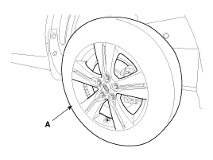
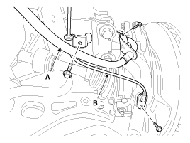
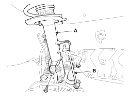
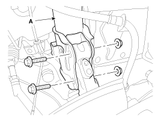
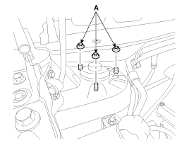
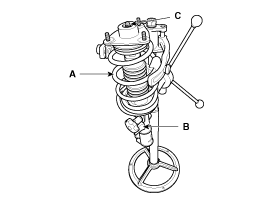
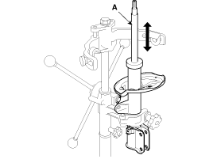
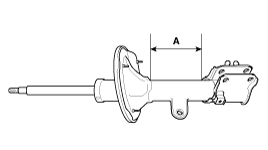

# Kia Sportage: Montagem de Estabilizador: Procedimentos de Reparo

[Home](../../index.md) / [Manual de Serviço e Reparo do Kia Sportage SL](../sportage-482.md) / [Sistema de Suspensão](sportage-813.md) / [Sistema de Suspensão da Dianteira](sportage-817.md) / Procedimentos de Reparo da Montagem de Estabilizador

## Troca

1. Remova a roda dianteira e o pneu.

   ```
   Torque de aperto :
   88,3 ~ 107,9N.m (9,0 ~ 11,0kgf.m, 65,1 ~ 79,6lb-ft)
   ```

   

   > **Cuidado**
   >
   > - Cuide para não danificar as varetas de fixação da roda dianteira (A) ao remover a roda e o pneu.

2. Desconecte o tubo de freio (A) e o suporte do sensor de velocidade do rolo (B) da montagem de estabilizador ao soltar as varetas de fixação.

   

3. Desconecte a varetinha estabilizadora (B) da montagem de estabilizador (A) após soltar o parafuso do nato.

   ```
   Torque de aperto :
   98,1 ~ 117,7N.m (10,0 ~ 12,0kgf.m, 72,3 ~ 86,8lb-ft)
   ```

   

4. Desconecte a montagem de estabilizador (A) com o buxo ao soltar o parafuso e o nato.

   ```
   Torque de aperto :
   137,3 ~ 156,9N.m (14,0 ~ 16,0kgf.m, 101,3 ~ 115,7lb-ft)
   ```

   

5. Remova o capô superior.

   Consulte o grupo do Corpo - Capô Superior

6. Remova a montagem de estabilizador e, em seguida, solte os parafusos de fixação do estabilizador (A).

   ```
   Torque de aperto :
   44,1 ~ 58,8N.m (4,5 ~ 6,0kgf.m, 32,5 ~ 43,4lb-ft)
   ```

   

7. A instalação é o contrário da remoção.

## Desmontagem

1. Use a ferramenta especial (09546-26000) para comprimir a mola helicoidal (A).

   

2. Remova o parafuso de trava de segurança (C) da montagem de estabilizador (B).

3. Remova o isolador, a base da mola e a cobertura de sujeira da montagem de estabilizador.

4. A reamontagem é o contrário da desmontagem.

## Inspeção

1. Verifique o rolamento do estabilizador para desgaste e danos.

2. Verifique a base superior e inferior da mola para danos e deterioração.

3. Comprenda e estenda o pistão (A) e verifique se há resistência anormal ou som incomum durante a operação.

   

Descarte

1. Estenda completamente o pistão.

2. Faça um buraco na seção A para remover o gás do cilindro.

   

   > **Cuidado**
   >
   > - O gás que sai é inofensivo, mas tenha cuidado com os pedaços que podem voar ao fazer o buraco.
   > - Certifique-se de usar óculos de segurança ou proteção ocular ao realizar esta tarefa.
