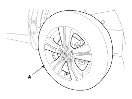
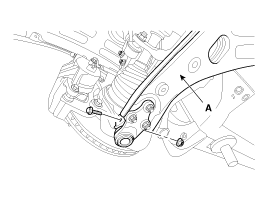
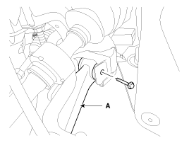
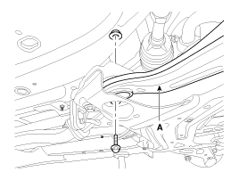

# Kia Sportage: Braço Baixo da Suspensão Frontal: Procedimentos de Reparo

[Home](../../index.md) / [Manual de Serviço e Reparo do Kia Sportage SL](../sportage-482.md) / [Sistema de Suspensão](sportage-813.md) / [Sistema de Suspensão Frontal](sportage-817.md) / Procedimentos de Reparo do Braço Baixo da Suspensão Frontal

## Troca

1. Remova a roda dianteira e o pneu.

   ```
   Torque de aperto :
   88.3 ~ 07.9N.m (9.0 ~ 11.0kgf.m, 65.1 ~ 79.6lb-ft)
   ```

   

   > **Cuidado**
   >
   > - Tenha cuidado para não danificar os parafusos do hub ao remover a roda dianteira e o pneu (A).

2. Desloque o parafuso e a tampa e, em seguida, remova o braço baixo (A).

   ```
   Torque de aperto :
   98.1 ~ 117.7N.m (10.0 ~ 12.0kgf.m, 72.3 ~ 86.8lb-ft)
   ```

   

3. Remova o braço baixo da suspensão dianteira do baiço do eixo dianteiro usando o SST (0K545-A9100).

   | (1) | Após remover os parafusos do baiço do eixo dianteiro, instale e aperte o parafuso do baiço (A). |
   | --- | --- |

   | (2) | Insira o baiço (A) entre o baiço do eixo dianteiro e o parafuso do baiço. |
   | --- | --- |

   | (3) | Ajuste o parafuso (B) do parafuso do baiço para ampliar o espaço entre o baiço do eixo dianteiro. |
   | --- | --- |

   | (4) | Instale a fita de segurança (A). Instale a fita de segurança no baiço do estabilizador para prevenir a queda do SST e ferir os técnicos. |
   | --- | --- |
   | Instale a fita de segurança no baiço do estabilizador para prevenir a queda do SST e ferir os técnicos. | |

   | (5) | Instale o corpo principal entre o baiço do estabilizador e o braço baixo. |
   | --- | --- |

   | (6) | Para evitar que o corpo principal se solte, instale um travamento (A) ao lado do corpo principal. |
   | --- | --- |

   | (7) | Após instalar o travamento, roteie o cabo (B) no sentido horário até que o travamento esteja fixo no braço baixo. |
   | --- | --- |

   | (8) | Ajuste o parafuso principal (A) do corpo principal lentamente e remova o braço baixo do baiço do eixo dianteiro. |
   | --- | --- |

4. Remova o braço baixo da suspensão dianteira (A) e, em seguida, desloque o parafuso (B, C).

   ```
   Torque de aperto :
   Parafuso (B)
   117.7 ~ 137.3N.m (12.0 ~ 14.0kgf.m, 86.8 ~ 101.3lb-ft)
   Parafuso (C)
   137.3 ~ 156.9N.m (14.0 ~ 16.0kgf.m, 101.3 ~ 115.7lb-ft)
   ```

   

   

5. A instalação é o inverso da remoção.

## Inspeção

1. Verifique a amortiguadora para desgaste e deterioração.

2. Verifique o braço baixo para deformação ou quebra.

3. Verifique o braço baixo para deformação.

4. Verifique todos os parafusos e tarraxas.
