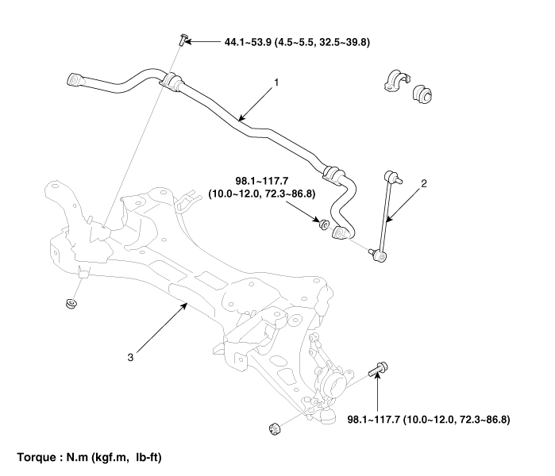

# Barra Estabilizadora da Dianteira — Componentes e localização

[Home](../../index.md) / [Manual de Serviço e Reparo](../sportage-482.md) / [Sistema de Suspensão](sportage-813.md) / [Sistema de Suspensão Dianteira](sportage-817.md) / Componentes e localização

## Diagrama

## Legenda

| Nº | Componente |
| --- | --- |
| 1 | Barra estabilizadora |
| 2 | Ligação da barra estabilizadora |
| 3 | Subquadro |
