# Kia Sportage: Barra Estabilizadora da Dianteira: Procedimentos de Reparo

[Home](../../index.md) / [Manual de Serviço e Reparo do Kia Sportage SL](../sportage-482.md) / [Sistema de Suspensão](sportage-813.md) / [Sistema de Suspensão Dianteira](sportage-817.md) / Procedimentos de Reparo da Barra Estabilizadora da Dianteira

## Troca

1. Remova a roda dianteira e o pneu.

   ```
   Torque de aperto:
   88,3 ~ 107,9N.m (9,0 ~ 11,0kgf.m, 65,1 ~ 79,6lb-ft)
   ```

   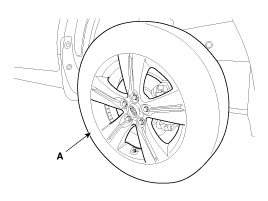

   > **Cuidado**
   >
   > - Tenha cuidado para não danificar os parafusos do hub ao remover a roda dianteira e o pneu (A).

2. Desconecte a barra estabilizadora (B) do conjunto do amortecedor dianteiro (A) após desafinar o parafuso.

   ```
   Torque de aperto:
   98,1 ~ 117,7N.m (10,0 ~ 12,0kgf.m, 72,3 ~ 86,8lb-ft)
   ```

   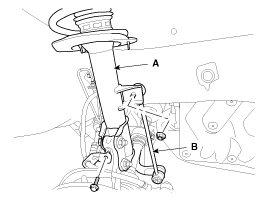

3. Remova o alfinete e o parafuso de castelo e, em seguida, desconecte o final de eixo de guia (A) do buxo dianteiro.

   ```
   Torque de aperto:
   34,3 ~ 44,1N.m (3,5 ~ 4,5kgf.m, 25,3 ~ 32,5lb-ft)
   ```

   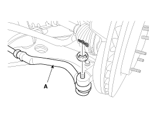

4. Desafine o parafuso e o parafuso de castelo e, em seguida, remova o braço inferior (A).

   ```
   Torque de aperto:
   98,1 ~ 117,7N.m (10,0 ~ 12,0kgf.m, 72,3 ~ 86,8lb-ft)
   ```

   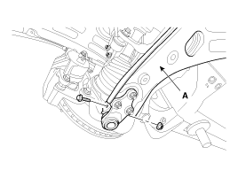

5. Remova o braço inferior dianteiro do buxo dianteiro usando o SST (0K545-A9100).

   | (1) | Após remover os parafusos do buxo dianteiro, instale e aperte o parafuso do sub-corpo (A). |
   | --- | --- |

   | (2) | Insira o sub-corpo (A) entre o buxo dianteiro e o parafuso do sub-corpo. |
   | --- | --- |

   | (3) | Ajuste o parafuso (B) do parafuso do sub-corpo para ampliar o espaço entre os buxos dianteiros. |
   | --- | --- |

   | (4) | Instale a fita de segurança (A). Instale uma fita de segurança no amortecedor dianteiro para prevenir a queda do SST e ferir os técnicos. |
   | --- | --- |

   | (5) | Instale o corpo principal entre o amortecedor dianteiro e o braço inferior. |
   | --- | --- |

   | (6) | Para evitar que o corpo principal se solte, instale um aperto de fixação (A) ao lado do corpo principal. |
   | --- | --- |

   | (7) | Após instalar o aperto de fixação, gire o manopla (B) no sentido horário até que o aperto esteja fixo no braço inferior. |
   | --- | --- |

   | (8) | Ajuste o parafuso principal (A) do corpo lentamente e remova o braço inferior do buxo dianteiro. |
   | --- | --- |

6. Remova a capa de proteção.

7. Desafine o parafuso (A) e, em seguida, desconecte a unidade universal do pinhão da caixa de direção.

   ```
   Torque de aperto:
   29,4 ~ 34,3N.m (3,0 ~ 3,5kgf.m, 21,7 ~ 25,3lb-ft)
   ```

   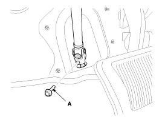

   > **Cuidado**
   >
   > - Mantenha o intervalo neutro para evitar danos à mola interna do molaspring quando manipular a roda direcional.
   > - Não use o parafuso novamente.

8. Remova a capa inferior (A).

   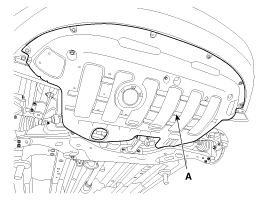

9. Desafine o parafuso (A) e o parafuso (B) e, em seguida, remova o parafuso de parada do rolamento.

   ```
   Torque de aperto:
   107,9 ~ 127,5N.m (11,0 ~ 13,0kgf.m, 79,6 ~ 94,0lb-ft)
   ```

   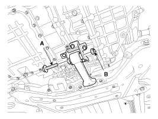

10. Desconecte o alçapão do escapamento (A).

    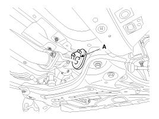

11. Desafine os parafusos e parafusos e, em seguida, remova o sub-corpo.

    ```

Tightening torque :
176,5 ~ 196,1N.m (18,0 ~ 20,0kgf.m, 130,2 ~ 144,7lb-ft)

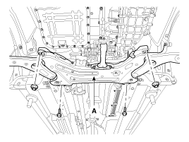

12. Desloque a viga (A) do subquadro, depois remova-a.

   Tightening torque :
   44,1 ~ 53,9N.m (4,5 ~ 5,5kgf.m, 32,5 ~ 39,8lb-ft)

   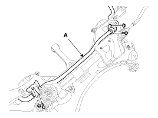

   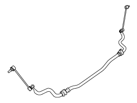

13. A instalação é o contrário da remoção.

## Inspeção

1. Verifique a amortecedor para desgaste e deterioração.

2. Verifique o barra estabilizadora dianteira para deformação.

3. Verifique a articulação esferoidal do link da barra estabilizadora dianteira para danos.
