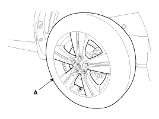
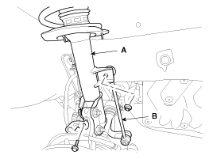
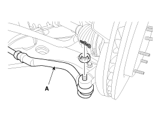
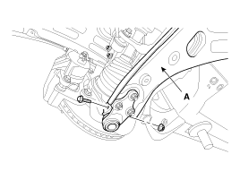
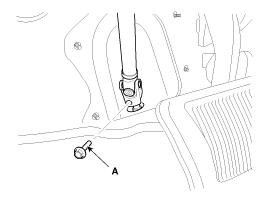
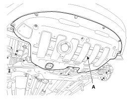
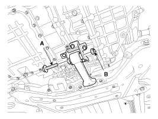
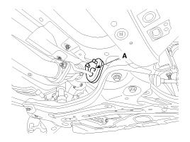
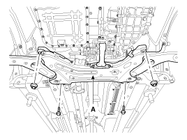

# Kia Sportage: Membro Transversal da Dianteira: Procedimentos de Reparo

[Início](../../index.md) / [Manual de Serviço e Reparo do Kia Sportage SL](../sportage-482.md) / [Sistema de Suspensão](sportage-813.md) / [Sistema de Suspensão da Dianteira](sportage-817.md) / Procedimentos de Reparo do Membro Transversal da Dianteira

## Troca

1. Remova o pneu e a roda da frente.

   ```
   Torque de aperto:
   88,3 ~ 107,9N.m (9,0 ~ 11,0kgf.m, 65,1 ~ 79,6lb-ft)
   ```

   

   > **Cuidado**
   >
   > - Tenha cuidado para não danificar os parafusos do eixo quando remover o pneu e a roda da frente (A).

2. Desconecte a barra estabilizadora (B) do conjunto do amortecedor da frente (A) após desafinar o parafuso.

   ```
   Torque de aperto:
   98,1 ~ 117,7N.m (10,0 ~ 12,0kgf.m, 72,3 ~ 86,8lb-ft)
   ```

   

3. Remova o alfinete e o parafuso de castelo e, em seguida, desconecte o final de ligação do eixo (A) do buço da frente.

   ```
   Torque de aperto:
   34,3 ~ 44,1N.m (3,5 ~ 4,5kgf.m, 25,3 ~ 32,5lb-ft)
   ```

   

4. Desafine o parafuso e o parafuso de castelo e, em seguida, remova o braço inferior (A).

   ```
   Torque de aperto:
   98,1 ~ 117,7N.m (10,0 ~ 12,0kgf.m, 72,3 ~ 86,8lb-ft)
   ```

   

5. Remova o braço inferior da frente do buço da frente usando o SST (0K545-A9100).

   | (1) | Após remover os parafusos do buço da frente, instale e aperte o parafuso do sub-corpo (A). |
   | --- | --- |

   | (2) | Insira o sub-corpo (A) entre o buço da frente e o parafuso do sub-corpo. |
   | --- | --- |

   | (3) | Ajuste o parafuso (B) do parafuso do sub-corpo para ampliar o espaço entre os buços da frente. |
   | --- | --- |

   | (4) | Instale a fita de segurança (A). Instale uma fita de segurança no amortecedor da frente para prevenir a queda do SST e ferir os técnicos. |
   | --- | --- |

   | (5) | Instale o corpo principal entre o amortecedor da frente e o braço inferior. |
   | --- | --- |

   | (6) | Para evitar que o corpo principal caia, instale um fecho (A) ao lado do corpo principal. |
   | --- | --- |

   | (7) | Após instalar o fecho, gire o manípulo (B) no sentido horário até que o fecho esteja fixo no braço inferior. |
   | --- | --- |

   | (8) | Ajuste lentamente o parafuso (A) do corpo principal e remova o braço inferior do buço da frente. |
   | --- | --- |

6. Remova a capa de proteção.

7. Desafine o parafuso (A) e, em seguida, desconecte a unidade universal do pinhão do box do volante.

   ```
   Torque de aperto:
   29,4 ~ 34,3N.m (3,0 ~ 3,5kgf.m, 21,7 ~ 25,3lb-ft)
   ```

   

   > **Cuidado**
   >
   > - Mantenha o intervalo neutro para prevenir o dano ao cabo interno do muelle do relógio quando manipular o volante.
   > - Não use o parafuso novamente.

8. Remova o cobertor inferior (A).

   

9. Desafine o parafuso (A) e o parafuso (B) e, em seguida, remova o parafuso de parada do rolamento.

   ```
   Torque de aperto:
   107,9 ~ 127,5N.m (11,0 ~ 13,0kgf.m, 79,6 ~ 94,0lb-ft)
   ```

   

10. Desconecte o alçapão do escapamento (A).

    

11. Desafine os parafusos e parafusos de castelo e, em seguida, remova o sub-corpo.

    ```

Tightening torque :
176,5 ~ 196,1N.m (18,0 ~ 20,0kgf.m, 130,2 ~ 144,7lb-ft)



12. Remova o braço inferior dianteiro.

   (Consulte o braço inferior dianteiro)

13. Remova o estabilizador dianteiro.

   (Consulte o estabilizador dianteiro)

14. Remova a caixa de direção.

   (Consulte a "Caixa de Direção" no grupo ST)

15. A instalação é a reversa do desmonte.
