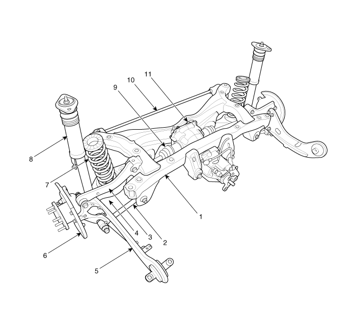
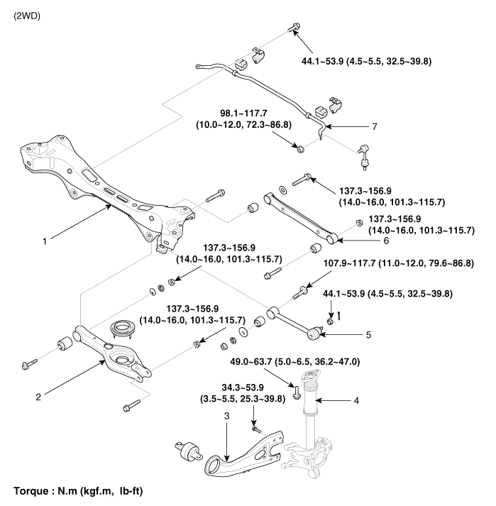
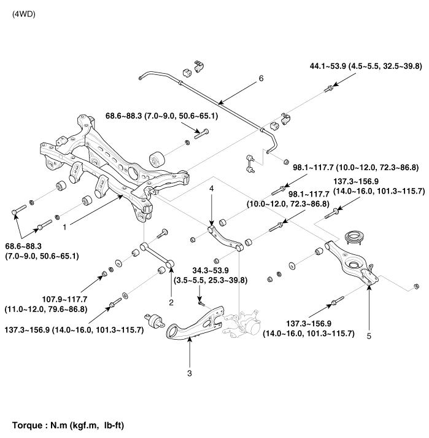

# Sistema de Suspensão Traseira — Componentes e localização

[Home](../../index.md) / [Manual de Serviço e Reparo](../sportage-482.md) / [Sistema de Suspensão](sportage-813.md) / [Sistema de Suspensão Traseira](sportage-825.md) / Componentes e localização

## Diagrama — Localização

## Legenda — Localização

| Nº | Componente |
| --- | --- |
| 1 | Sub quadro |
| 2 | Braço auxiliar |
| 3 | Braço superior |
| 4 | Braço inferior |
| 5 | Braço traseiro |
| 6 | Eixo traseiro |
| 7 | Amortecedor helicoidal |
| 8 | Amortecedor |
| 9 | Eixo de transmissão |
| 10 | Estabilizador |
| 11 | Carrinho diferencial |

## Diagrama — Componentes

## Legenda — Componentes

| Nº | Componente |
| --- | --- |
| 1 | Sub quadro |
| 2 | Braço inferior |
| 3 | Braço traseiro |
| 4 | Amortecedor |
| 5 | Braço auxiliar |
| 6 | Braço superior |
| 7 | Barra de estabilização |

## Diagrama — Componentes

## Legenda — Componentes

| Nº | Componente |
| --- | --- |
| 1 | Sub quadro |
| 2 | Braço auxiliar |
| 3 | Braço traseiro |
| 4 | Braço superior |
| 5 | Braço inferior |
| 6 | Barra de estabilização |
