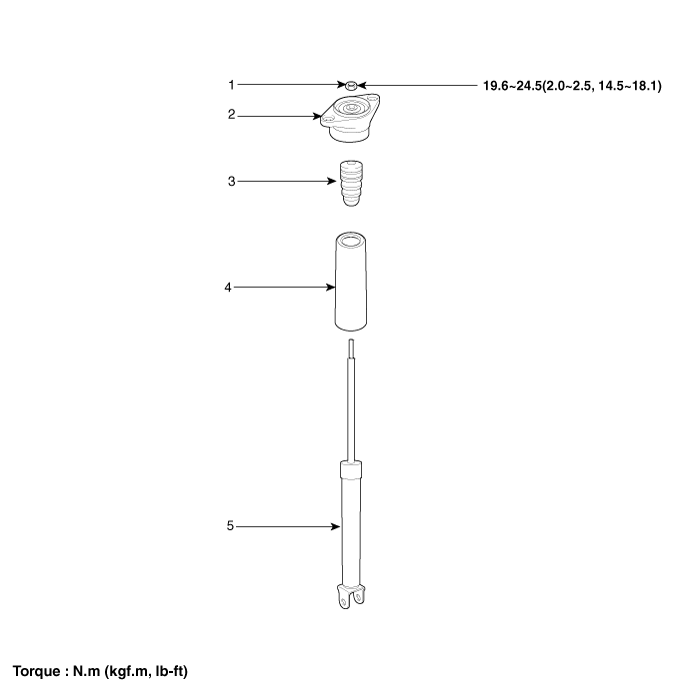

# Kia Sportage: Amortecedor Traseiro: Componentes e Localização dos Componentes

[Home](../../index.md) / [Manual de Serviço e Reparo do Kia Sportage SL](../sportage-482.md) / [Sistema de Suspensão](sportage-813.md) / [Sistema de Suspensão Traseiro](sportage-825.md) / Componentes e Localização dos Componentes do Amortecedor Traseiro

## Componentes

| 1. Fita de travamento 2. Montagem do suporte 3. Suporte de bumerangue de borracha | 4. Cobertura antirrugião 5. Amortecedor |
| --- | --- |
