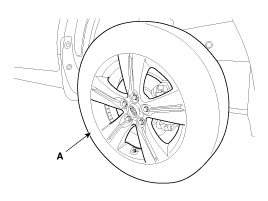
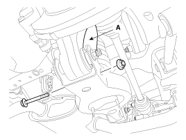
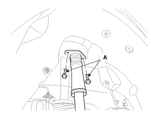
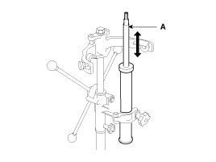

# Kia Sportage: Amortecedor Traseiro: Procedimentos de Reparo

[Home](../../index.md) / [Manual de Serviço e Reparo do Kia Sportage SL](../sportage-482.md) / [Sistema de Suspensão](sportage-813.md) / [Sistema de Suspensão Traseiro](sportage-825.md) / Procedimentos de Reparo do Amortecedor Traseiro

## Troca

1. Remova a roda traseira e o pneu.

   ```
   Torque de aperto :
   88,3 ~ 107,9N.m (9,0 ~ 11,0kgf.m, 65,1 ~ 79,6lb-ft)
   ```

   

   > **Cuidado**
   >
   > - Cuide para não danificar os parafusos do hub (A) ao remover a roda e o pneu da frente (A).

2. Desafine o parafuso e a tampa e, em seguida, desconecte o amortecedor (A) do eixo traseiro.

   ```
   Torque de aperto :
   137,3 ~ 156,9N.m (14,0 ~ 16,0kgf.m, 101,3 ~ 115,7lb-ft)
   ```

   

3. Desafine os parafusos de montagem do amortecedor (A).

   ```
   Torque de aperto :
   49,0 ~ 63,7N.m (5,0 ~ 6,5kgf.m, 36,2 ~ 47,0lb-ft)
   ```

   

4. A instalação é o inverso da remoção.

## Inspeção

1. Verifique as partes elásticas para desgaste e deterioração.

2. Compreenda e estenda o pistão (A) e verifique se há resistência anormal ou som incomum durante a operação.

   
