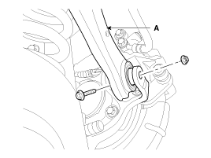
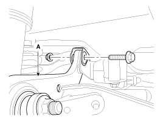
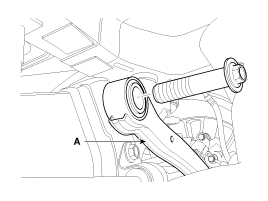
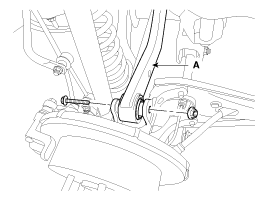

# Kia Sportage: Braço Superior Traseiro: Procedimentos de Reparo

[Home](../../index.md) / [Manual de Serviço e Reparo do Kia Sportage SL](../sportage-482.md) / [Sistema de Suspensão](sportage-813.md) / [Sistema de Suspensão Traseira](sportage-825.md) / Procedimentos de Reparo do Braço Superior Traseiro

## Troca

1. Remova a roda traseira e o pneu.

   ```
   Torque de aperto:
   88,3 ~ 107,9 N.m (9,0 ~ 11,0 kgf.m, 65,1 ~ 79,6 lb-ft)
   ```

   

   > **Cuidado**
   >
   > - Cuide para não danificar os parafusos do hub ao remover a roda e o pneu da frente (A).

2. Solte o parafuso e a tampa e remova o braço superior traseiro (A) junto com o eixo traseiro.

   ```
   Torque de aperto:
   2WD
   137,3 ~ 156,9 N.m (14,0 ~ 16,0 kgf.m, 101,3 ~ 115,7 lb-ft)
   4WD
   98,1 ~ 117,7 N.m (10,0 ~ 12,0 kgf.m, 72,3 ~ 86,8 lb-ft)
   ```

   [2WD]

   

   [4WD]

   

3. Solte o parafuso e a tampa e remova o braço superior traseiro (A) junto com o subquadro.

   ```
   Torque de aperto:
   2WD
   137,3 ~ 156,9 N.m (14,0 ~ 16,0 kgf.m, 101,3 ~ 115,7 lb-ft)
   4WD
   98,1 ~ 117,7 N.m (10,0 ~ 12,0 kgf.m, 72,3 ~ 86,8 lb-ft)
   ```

   [2WD]

   

   [4WD]

   

4. A instalação é o inverso da remoção.

   > **Cuidado**
   >
   > - Instale o braço superior traseiro de forma que a letra "R" fique voltada para trás do veículo.

## Inspeção

1. Verifique a amortecedor para desgaste e deterioração.

2. Verifique o braço superior traseiro para danos e deformações.

3. Verifique todos os parafusos e tampa.
