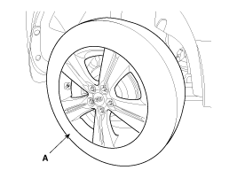
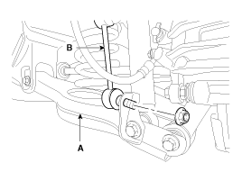
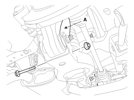
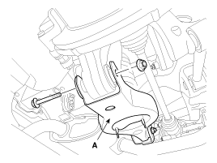
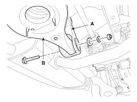

# Kia Sportage: Braço Baixo Traseiro: Procedimentos de Reparo

[Home](../../index.md) / [Manual de Serviço e Reparo do Kia Sportage SL](../sportage-482.md) / [Sistema de Suspensão](sportage-813.md) / [Sistema de Suspensão Traseiro](sportage-825.md) / Procedimentos de Reparo do Braço Baixo Traseiro

## Troca

1. Remova a roda traseira e o pneu.

   ```
   Torque de aperto :
   88,3 ~ 107,9N.m (9,0 ~ 11,0kgf.m, 65,1 ~ 79,6lb-ft)
   ```

   

   > **Cuidado**
   >
   > - Cuide para não danificar os parafusos do hub ao remover a roda traseira e o pneu (A).

2. Aos soltar o parafuso e, em seguida, remova a alça estabilizadora traseira (B) com o braço baixo traseiro (A).

   ```
   Torque de aperto :
   98,1 ~ 117,7N.m (10,0 ~ 12,0kgf.m, 72,3 ~ 86,8lb-ft)
   ```

   

3. Aos soltar o parafuso e o parafuso do buge e, em seguida, remova o amortecedor traseiro (A) com o braço baixo.

   ```
   Torque de aperto :
   137,3 ~ 156,9N.m (14,0 ~ 16,0kgf.m, 101,3 ~ 115,7lb-ft)
   ```

   

4. Aos soltar o parafuso e o parafuso do buge e, em seguida, remova o braço baixo traseiro (A) com o eixo traseiro.

   ```
   Torque de aperto :
   137,3 ~ 156,9N.m (14,0 ~ 16,0kgf.m, 101,3 ~ 115,7lb-ft)
   ```

   

5. Aos soltar o parafuso e o parafuso do buge e, em seguida, remova o braço baixo traseiro (B) com o subquadro (A).

   ```
   Torque de aperto :
   137,3 ~ 156,9N.m (14,0 ~ 16,0kgf.m, 101,3 ~ 115,7lb-ft)
   ```

   

6. A montagem é o inverso da remoção.

## Inspeção

1. Verifique o amortecedor para desgaste e deterioração.

2. Verifique o braço baixo traseiro para deformação.

3. Verifique a mola helicoidal e a placa de mola para deterioração e deformação.

4. Verifique todos os parafusos e parafusos.
