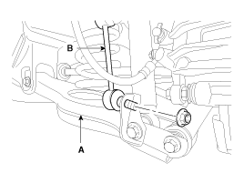
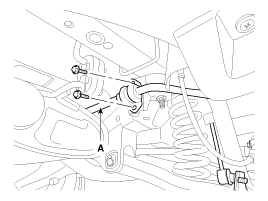

# Kia Sportage: Barras Estabilizadoras Traseiras: Procedimentos de Reparo

[Home](../../index.md) / [Manual de Serviço e Reparo do Kia Sportage SL](../sportage-482.md) / [Sistema de Suspensão](sportage-813.md) / [Sistema de Suspensão Traseira](sportage-825.md) / Barras Estabilizadoras Traseiras: Procedimentos de Reparo

## Troca

1. Remova a roda traseira e o pneu.

   ```
   Torque de aperto:
   88,3 ~ 107,9 N.m (9,0 ~ 11,0 kgf.m, 65,1 ~ 79,6 lb-ft)
   ```

   

   > **Cuidado**
   >
   > - Cuide para não danificar as varetas do eixo dianteiro (A) ao remover a roda e o pneu dianteiro.

2. Aproveite-se de soltar o parafuso e remova a vareta estabilizadora traseira (B) com o braço inferior traseiro (A).

   ```
   Torque de aperto:
   98,1 ~ 117,7 N.m (10,0 ~ 12,0 kgf.m, 72,3 ~ 86,8 lb-ft)
   ```

   

3. Aproveite-se de soltar o parafuso de montagem e remova a barra estabilizadora (A) com o subquadro.

   ```
   Torque de aperto:
   44,1 ~ 53,9 N.m (4,5 ~ 5,5 kgf.m, 32,5 ~ 39,8 lb-ft)
   ```

   

4. A montagem é o inverso da remoção.

## Inspeção

1. Verifique a barra estabilizadora traseira para deformações.

2. Verifique a articulação do balinete da vareta estabilizadora traseira para danos.
