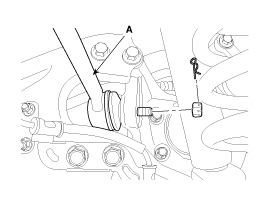
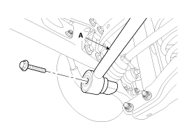
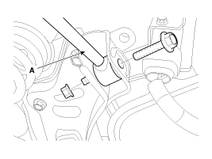
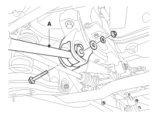

# Kia Sportage: Braço de Assistência Traseira: Procedimentos de Reparo

[Home](../../index.md) / [Manual de Serviço e Reparo do Kia Sportage SL](../sportage-482.md) / [Sistema de Suspensão](sportage-813.md) / [Sistema de Suspensão Traseira](sportage-825.md) / Procedimentos de Reparo do Braço de Assistência Traseira

## Troca

1. Remova a roda traseira e o pneu.

   ```
   Torque de aperto:
   88,3 ~ 107,9 N.m (9,0 ~ 11,0 kgf.m, 65,1 ~ 79,6 lb-ft)
   ```

   

   > **Cuidado**
   >
   > - Cuide para não danificar os parafusos do hub ao remover a roda e o pneu da frente (A).

2. Remova o pinhão e a coroa ou parafuso e, em seguida, desconecte o braço de assistência traseira (A) do eixo traseiro.

   ```
   Torque de aperto:
   2WD
   44,1 ~ 53,9 N.m (4,5 ~ 5,5 kgf.m, 32,5 ~ 39,8 lb-ft)
   4WD
   137,3 ~ 156,9 N.m (14,0 ~ 16,0 kgf.m, 101,3 ~ 115,7 lb-ft)
   ```

   [2WD]

   

   [4WD]

   

3. Desenrole o parafuso e a coroa e, em seguida, remova o braço de assistência traseira (A) do subquadro.

   ```
   Torque de aperto:
   107,9 ~ 117,7 N.m (11,0 ~ 12,0 kgf.m, 79,6 ~ 86,8 lb-ft)
   ```

   [2WD]

   

   [4WD]

   

4. A instalação é o inverso da remoção.

## Inspeção

1. Verifique a amortecedor para desgaste e deterioração.

2. Verifique o braço de assistência traseira para deformação.

3. Verifique a articulação de bola para danos.

4. Verifique todos os parafusos e coronas.
