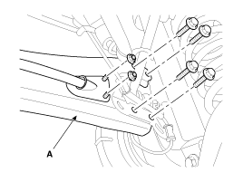
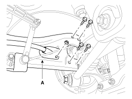
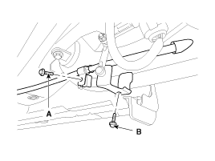
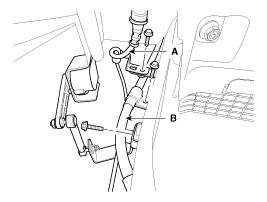
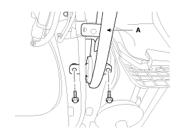

# Kia Sportage: Trave de Traseira: Procedimentos de Reparo

[Home](../../index.md) / [Manual de Serviço e Reparo do Kia Sportage SL](../sportage-482.md) / [Sistema de Suspensão](sportage-813.md) / [Sistema de Suspensão Traseira](sportage-825.md) / Procedimentos de Troca da Trave de Traseira

## Troca

1. Remova a roda traseira e o pneu.

   ```
   Torque de aperto :
   88,3 ~ 107,9 N.m (9,0 ~ 11,0 kgf.m, 65,1 ~ 79,6 lb-ft)
   ```

   

   > **Cuidado**
   >
   > - Cuide para não danificar as varetas de fixação da roda dianteira (A) ao remover a roda dianteira e o pneu.

2. Desloque os parafusos e as varetas e remova a trave de traseira (A) do eixo traseiro.

   ```
   Torque de aperto
   34,3 ~ 53,9 N.m (3,5 ~ 5,5 kgf.m, 25,3 ~ 39,8 lb-ft)
   ```

   [2WD]

   

   [4WD]

   

3. Desloque o parafuso do suporte do cabo do freio de estacionamento (A) e do suporte do sensor de altura (B).

   [2WD]

   

   [4WD]

   

4. Desloque o parafuso de montagem e remova a trave de traseira (A) junto ao chassi.

   ```
   Torque de aperto :
   98,1 ~ 117,7 N.m (10,0 ~ 12,0 kgf.m, 72,3 ~ 86,8 lb-ft)
   ```

   

5. A instalação é o processo inverso da remoção.
