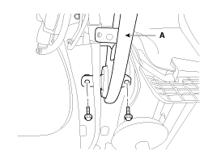
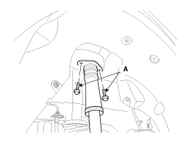
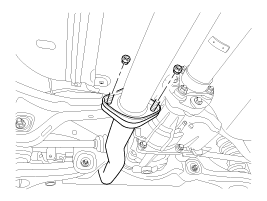
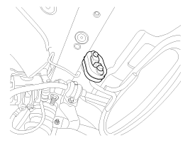
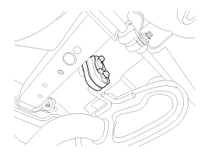
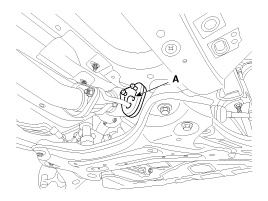
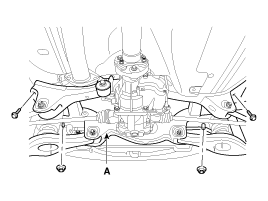

# Kia Sportage: Membro Transversal Traseiro: Procedimentos de Reparo

[Home](../../index.md) / [Manual de Serviço e Reparo do Kia Sportage SL](../sportage-482.md) / [Sistema de Suspensão](sportage-813.md) / [Sistema de Suspensão Traseiro](sportage-825.md) / Procedimentos de Reparo do Membro Transversal Traseiro

## Troca

1. Remova a roda traseira e o pneu.

   ```
   Torque de aperto:
   88,3 ~ 107,9 N.m (9,0 ~ 11,0 kgf.m, 65,1 ~ 79,6 lb-ft)
   ```

   

   > **Cuidado**
   >
   > - Cuide para não danificar as varetas de fixação da roda (A) ao remover a roda e o pneu da frente.

2. Remova o cabo do freio de estacionamento.

   (Consulte o "Sistema de Freio de Estacionamento" no grupo BR)

3. Desafinque a vareta de fixação e, em seguida, remova o braço traseiro (A).

   ```
   Torque de aperto:
   98,1 ~ 117,7 N.m (10,0 ~ 12,0 kgf.m, 72,3 ~ 86,8 lb-ft)
   ```

   

4. Desafinque as varetas de fixação do amortecedor (A).

   ```
   Torque de aperto:
   49,0 ~ 63,7 N.m (5,0 ~ 6,5 kgf.m, 36,2 ~ 47,0 lb-ft)
   ```

   

5. Remova o silenciador traseiro.

   

   

   

6. Desafinque a vareta de fixação e, em seguida, remova o eixo propulsor (A).

   

7. Desafinque as varetas de fixação e, em seguida, remova o membro transversal traseiro (A) junto ao chassis.

   ```
   Torque de aperto:
   156,9 ~ 176,5 N.m (16,0 ~ 18,0 kgf.m, 115,7 ~ 130,2 lb-ft)
   ```

   

8. Remova o braço traseiro inferior.

   (Consulte o braço traseiro inferior)

9. Remova o amortecedor traseiro.

   (Consulte o amortecedor traseiro)

10. Remova o braço traseiro superior.

    (Consulte o braço traseiro superior)

11. Remova o braço traseiro.

    (Consulte o braço traseiro)

12. Remova o braço auxiliar traseiro.

    (Consulte o braço auxiliar traseiro)

13. Remova o eixo traseiro.

    (Consulte o "Eixo Traseiro" no grupo DS)

14. Remova o carreador diferencial.

    (Consulte o "Carreador Diferencial" no grupo DS)

15. A instalação é o contrário da remoção.
