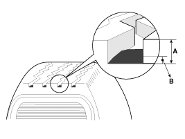
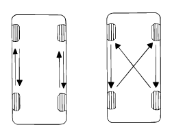
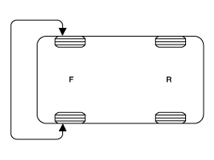
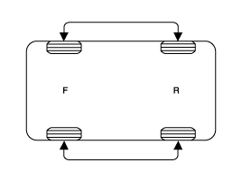
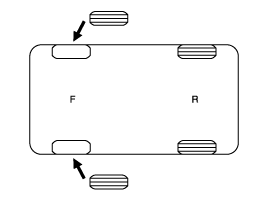

# Kia Sportage: Pneu: Procedimentos de reparo

[Home](../../index.md) / [Manual de Serviço e Reparo do Kia Sportage SL](../sportage-482.md) / [Sistema de Suspensão](sportage-813.md) / [Pneus / Rodas](sportage-835.md) / Pneu: Procedimentos de reparo

## Desgaste do pneu

1. Medir a profundidade do sulco do pneu.

   ```
   Profundidade do sulco [limite] : 1,6 mm (0,063 pole.)
   ```

2. Se a profundidade residual do sulco (A) for menor que o limite, substituir o pneu.

   > **Nota**
   >
   > - Quando a profundidade do sulco dos pneus for menor que 1,6 mm (0,063 pole.), as indicadores de desgaste (B) aparecerão.

   

Rotatividade do Pneu

Rotacionar os pneus no padrão ilustrado.



Verificação de Desvio e Deslizamento

Caso o direção desvie para um lado, rotacionar os pneus de acordo com o procedimento de rotação de rodas a seguir.

1. Rotacionar os pneus da roda dianteira direita e esquerda, e realizar um teste de estrada para confirmar a estabilidade do veículo.

   

2. Se o direção desviar para o lado oposto, verificar a especificação de alinhamento das rodas antes de rotacionar os pneus de acordo com o procedimento de rotação de rodas a seguir.

   

3. Se o direção continuar a desviar para um lado, rotacionar novamente as rodas dianteira direita e esquerda, e realizar um teste de estrada.

   

4. Se o direção continuar a desviar para o lado oposto, substituir as rodas dianteiras por novas.

   
