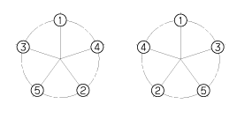
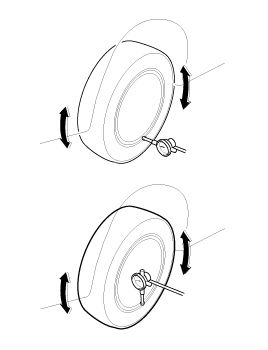

# Kia Sportage: Roda: Procedimentos de reparo

[Home](../../index.md) / [Manual de Serviço e Reparo do Kia Sportage SL](../sportage-482.md) / [Sistema de Suspensão](sportage-813.md) / [Pneus / Rodas](sportage-835.md) / Procedimentos de reparo da roda

## Sequência de aperto dos parafusos do hub

Aperte os parafusos do hub conforme indicado.

```
Torque de aperto:
88,3 ~ 107,9 N.m (9,0 ~ 11,0 kgf.m, 65,1 ~ 79,6 lb-ft)
```



> **Cuidado**
>
> - Ao usar uma ferramenta de impacto, o torque final deve ser verificado com uma chave de torque.

Inspeção de desalinhamento

1. Eleva o veículo.

2. Mede o desalinhamento da roda usando um indicador de disco conforme ilustrado abaixo.

   | Desalinhamento | Alumínio | Aço |
   | --- | --- | --- |
   | Radial mm(in.) | Menor que 0,3(0,012) | Menor que 1,0(0,039) |
   | Axial mm(in.) | Menor que 0,3(0,012) | Menor que 0,6(0,024) |

3. Se o valor medido exceder o valor padrão, substitua a roda.

   
