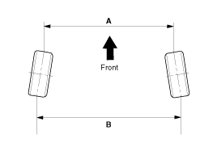
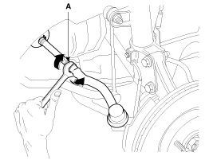
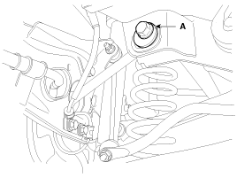

# Kia Sportage: Alinhamento: Procedimentos de reparo

[Home](../../index.md) / [Manual de Serviço e Reparo do Kia Sportage SL](../sportage-482.md) / [Sistema de Suspensão](sportage-813.md) / [Pneus / Rodas](sportage-835.md) / Procedimentos de reparo de alinhamento

## Alinhamento dos Pneus Dianteiros

> **Cuidado**
>
> - Ao usar equipamentos de alinhamento de pneus com computador comercial para verificar o alinhamento dos pneus dianteiros, sempre posicione o veículo em uma superfície nivela com os pneus dianteiros apontando para frente.
> - Antes da verificação, certifique-se de que o sistema de suspensão e direção estejam em condições normais de operação e que os pneus estejam inflados à pressão especificada.

**Alinhamento do Toque**



```
B - A > 0: Toque para dentro (+)
B - A < 0: Toque para fora (-)
```

**Ajuste do Toque**

1. Desafute o parafuso de bloqueio do extremo do eixo de ligação.

2. Remova a tira do bocal para prevenir a distorção do bocal.

3. Ajuste o toque girando o eixo de ligação. O ajuste do toque deve ser feito girando os eixos de ligação direito e esquerdo na mesma quantidade.

   ```
   Toque
   Total : 0°±0.2°
   Individual : 0°±0.1°
   ```

   | Eixo de ligação | Direção de giro | Toque |
   | --- | --- | --- |
   | LH (Lado do motorista) | Para trás | Diminuir (Toque para dentro) |
   | Para frente | Aumentar (Toque para fora) | |
   | RH | Para trás | Aumentar (Toque para fora) |
   | Para frente | Diminuir (Toque para dentro) | |

   

4. Após o ajuste do toque, instale a tira do bocal e aperte o parafuso de bloqueio do extremo do eixo de ligação até a torque especificada.

   ```
   Torque de aperto :
   49.0 ~ 53.9N.m (5.0 ~ 5.5kgf.m, 36.2 ~ 39.8lb-ft)
   ```

5. Ajuste o sensor do ângulo do volante após o ajuste do alinhamento dos pneus.

   (Consulte o Sistema de Direção - "Coluna do Volante")

**Ângulo de Camber e Caster**

O ângulo de Camber e Caster são pré-definidos na fábrica, então não precisam ser ajustados. Se o camber e o caster não estiverem dentro do valor padrão, substitua ou conserte as partes danificadas e, em seguida, realize a verificação novamente.

```
Ângulo de Camber : -0.5°±0.5°
```

```
Ângulo de Caster : 4.02 ° ± 0.5°
```

## Alinhamento dos Eixos Traseiros

> **Cuidado**
>
> - Ao usar um equipamento de alinhamento de rodas com computador para inspecionar o alinhamento dos eixos traseiros, sempre posicione o veículo em uma superfície nivela.
> - Antes da inspeção, certifique-se de que o sistema de suspensão traseira esteja em condições normais de operação e que as pneus estejam inflados conforme a pressão especificada.

Toque


```
B - A > 0: Toque para dentro (+)
B - A < 0: Toque para fora (-)
```

Ajuste de toque

1. Desafute o parafuso do braço auxiliar do amortecedor (A).

2. Ajuste o toque traseiro girando o parafuso do braço auxiliar do amortecedor (A) no sentido horário ou anti-horário. O ajuste de toque deve ser feito girando os parafusos do braço auxiliar do amortecedor à direita e à esquerda em quantidades iguais.

   ```
   Toque
   Total : 0.2°±0.2°
   Individual : 0.1°±0.1°
   ```

   | Parafuso | Direção de giro | Toque |
   | --- | --- | --- |
   | LH (Lado do motorista) | Horário | Diminuir (Toque para fora) |
   | Anti-horário | Aumentar (Toque para dentro) | |
   | RH | Horário | Aumentar (Toque para dentro) |
   | Anti-horário | Diminuir (Toque para fora) | |

   

3. Ao completar o ajuste de toque, aperte o parafuso com o torque especificado.

   ```
   Torque de aperto :
   107.9 ~ 117.7N.m (11.0 ~ 12.0kgf.m, 79.6 ~ 86.8lb-ft)
   ```

4. Corrija o sensor do ângulo do volante após ajustar o alinhamento das rodas.

   (Consulte o Sistema de Direção - "Coluna de Direção")

Câmbio

Ajuste o câmbio girando o parafuso do câmbio do braço inferior traseiro.

```
Câmbio: -1.0°±0.5°
```

| Parafuso | Direção de giro | Câmbio |
| --- | --- | --- |
| LH (Lado do motorista) | Horário | Câmbio - |
| Anti-horário | Câmbio + |  |
| RH | Horário | Câmbio + |
| Anti-horário | Câmbio - |  |
