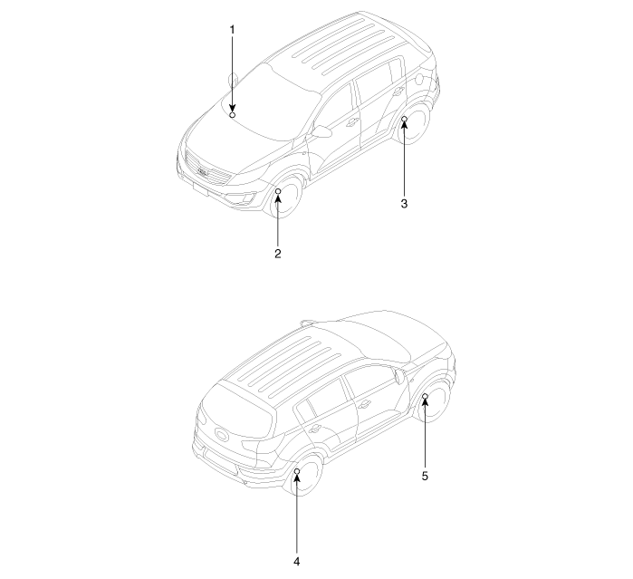

# Sistema de Monitoramento da Pressão dos Pneus — Componentes e localização

[Home](../../index.md) / [Manual de Serviço e Reparo](../sportage-482.md) / [Sistema de Suspensão](sportage-813.md) / [Sistema de Monitoramento da Pressão dos Pneus](sportage-839.md) / Componentes e localização

## Diagrama

## Legenda

| Nº | Componente |
| --- | --- |
| 1 | Receptor |
| 2 | Sensor de TPMS |
| 3 | Sensor de TPMS |
| 4 | Sensor de TPMS |
| 5 | Sensor de TPMS |
