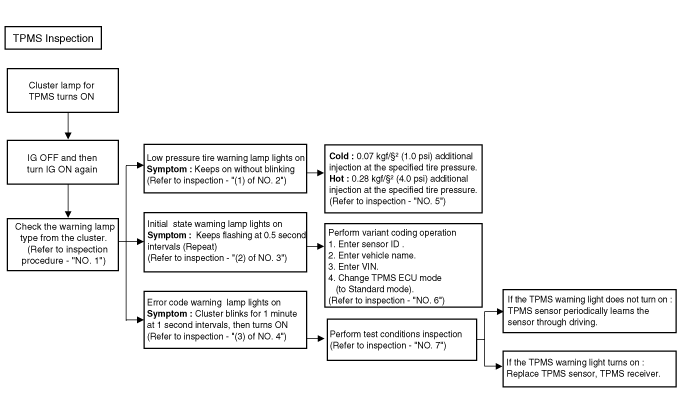

# Kia Sportage: Diagnóstico

[Home](../../index.md) / [Manual de Serviço e Reparo do Kia Sportage SL](../sportage-482.md) / [Sistema de Suspensão](sportage-813.md) / [Sistema de Monitoramento da Pressão dos Pneus](sportage-839.md) / Diagnóstico

## Método de Inspeção do SPM

## Inspeção

> **Nota**
>
> - Encontre o número de inspeção consultando a tabela acima.
> - O conteúdo a seguir é irrelevante para o procedimento de inspeção.

1. Tipos de luzes de advertência

   | • | Mantém-se acesa sem piscar : Luz de advertência de baixa pressão do pneu |
   | --- | --- |

   | • | Piscando a cada 0,5 segundos : Luz de estado inicial |
   | --- | --- |

   | • | Painel piscando a cada 1 segundo por 1 minuto, depois se acende : Luz de código de erro |
   | --- | --- |

   > **Nota**
   >
   > - Desligue IG e, em seguida, ligue novamente para verificar o tipo de luz de advertência.

2. (1) Verifique o estado da luz de advertência.

   | • | Verifique o estado das luzes de advertência do veículo. |
   | --- | --- |

   | • | Verifique se o estado da luz de advertência é causado pela baixa pressão do pneu. Sintoma : Mantém-se acesa sem piscar. |
   | --- | --- |

3. (2) Verifique o estado da luz de advertência.

   | • | Verifique o estado das luzes de advertência do veículo. |
   | --- | --- |

   | • | Verifique se o estado da luz de advertência é causado pelo estado inicial (modo virgin) do receptor do TPMS. Sintoma : Piscando a cada 0,5 segundos constantemente. |
   | --- | --- |

4. (3) Verifique o estado da luz de advertência.

   | • | Verifique o estado das luzes de advertência do veículo. |
   | --- | --- |

   | • | Verifique se o estado da luz de advertência é causado por um código de erro (falha do receptor do TPMS e do sensor do TPMS). Sintoma : Painel piscando a cada 1 segundo por 1 minuto, depois se acende. |
   | --- | --- |

5. Luz de advertência de baixa pressão do pneu

   Gelado : Veículo mantido por mais de 60 minutos após a parada.

   > Adicione 0,07 kgf/cm² (1,0 psi) na pressão do pneu especificada.

   Quente : Veículo em movimento

   > Adicione 0,28 kgf/cm² (4,0 psi) na pressão do pneu especificada.

   > **Nota**
   >
   > - Em caso de luz de advertência que não se apaga após a adição da pressão do pneu, desconecte o GDS e dirija menos de 1 km a 25 km/h.

6. Inspeção da luz de advertência de estado inicial

   A. Luz de advertência do TPMS

    (1) Verifique o status da luz de advertência do TPMS.

    (2) Piscando a cada 0,5 segundos constantemente. -> Luz de advertência de estado inicial

    > **Nota**
    >
    > - Desligue IG e, em seguida, ligue novamente para verificar o tipo de luz de advertência.

   B. Itens a serem verificados em caso de luz de advertência piscando

    (1) Entre com o ID do sensor.

    (Consulte o "Procedimento de reparo" do receptor do TPMS)

    (2) Entre com o nome do veículo.

    (Consulte o "Procedimento de reparo" do receptor do TPMS)

    (3) Entre com o VIN.

    (Consulte o "Procedimento de reparo" do receptor do TPMS)

    (4) Altere o modo do ECU do TPMS (para modo padrão).

7. Checklist de DTC para teste de desempenho.

   | Lista | sintomas | Itens de inspeção | Checklist detalhado | Componentes/parts |
   | --- | --- | --- | --- | --- |
   | C1312(FL) C1313(FR) C1314(RL) C1315(RR) | Erro de recepção do sensor do TPMS. | Estado de transmissão RF do sensor | Confirme o estado de transmissão RF do sensor Verifique o DTC do sensor Inspeção da bateria do sensor | Sensor do TPMS Unidades eletrônicas do veículo Ruídos do sistema eletrônico do veículo Condições de operação do veículo |

| C1332(FL) C1333(FR) C1334(RL) C1335(RR) | Falha no sensor interno | Verificar transmissão do sensor RF Verificar a tensão da bateria do sensor | Verificar transmissão do sensor RF Verificar a bateria do sensor (GDS) | TPMS Sensor |
   | C1662 | Falha no aprendizado automático | Estado da transmissão do sensor RF Verificar a velocidade do veículo (VS) do EMS Verificar o ruído do veículo | Confirmar a transmissão do sensor RF Verificar a bateria do sensor Verificar a velocidade do veículo (VS) do EMS Verificar o ruído da unidade eletrônica do veículo | TPMS Sensor Ruído da unidade eletrônica do veículo Condição de operação do veículo Velocidade do veículo (VS) do EMS |
   | C1663 | Falha no aprendizado automático | Estado da transmissão do sensor RF Verificar a velocidade do veículo (VS) do EMS Verificar o ruído do veículo | Confirmar a transmissão do sensor RF Verificar a bateria do sensor Verificar a velocidade do veículo (VS) do EMS Verificar o ruído da unidade eletrônica do veículo | TPMS Sensor Ruído da unidade eletrônica do veículo Condição de operação do veículo Velocidade do veículo (VS) do EMS |

   > **Nota**
   >
   > - Certifique-se de verificar o DTC.
   > - (Consulte o manual do DTC - "Monitoramento da Pressão do Pneu")
   > - Se a luz do TPMS não acender: o sensor do TPMS aprende periodicamente o sensor ao longo da viagem.
   > - Se a luz do TPMS acender: substitua o sensor do TPMS e a unidade recebedora do TPMS.
