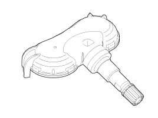

# Kia Sportage: TPMS Sensor: Descrição e Operação

[Home](../../index.md) / [Manual de Serviço e Reparo do Kia Sportage SL](../sportage-482.md) / [Sistema de Suspensão](sportage-813.md) / [Sistema de Monitoramento da Pressão dos Pneus](sportage-839.md) / TPMS Sensor: Descrição e Operação

## Descrição

1. Modo

   | (1) | Estado Fixo Normal • As transmissões dos sensores continuam nas taxas definidas na configuração de Linha Baixa (Estado Base) até que o estado seja alterado pelo comando LF ou pelo sensor detectar uma condição que exija uma mudança temporária para outro estado. • O comando LF para esse estado deve conter o ID do sensor. |
   | --- | --- |
   | • | As transmissões dos sensores continuam nas taxas definidas na configuração de Linha Baixa (Estado Base) até que o estado seja alterado pelo comando LF ou pelo sensor detectar uma condição que exija uma mudança temporária para outro estado. |
   | • | O comando LF para esse estado deve conter o ID do sensor. |

   | (2) | Estado de Armazenamento Automático: • Este estado é um estado de baixo consumo de corrente. • Os sensores estão neste estado quando chegam à concessionária (seja no veículo ou como peças de reposição). • Neste estado, o sensor não mede a pressão / temperatura / nível da bateria. • O sensor não transmite neste estado a menos que seja solicitado a fazê-lo pelo comando de iniciativa. |
   | --- | --- |
   | • | Este estado é um estado de baixo consumo de corrente. |
   | • | Os sensores estão neste estado quando chegam à concessionária (seja no veículo ou como peças de reposição). |
   | • | Neste estado, o sensor não mede a pressão / temperatura / nível da bateria. |
   | • | O sensor não transmite neste estado a menos que seja solicitado a fazê-lo pelo comando de iniciativa. |

   | (3) | Estado de Alerta: • O sensor automaticamente entra neste estado se a temperatura medida ultrapassar 230 °F (110 °C) e a sobrecarga de temperatura for provável. • Neste estado, a pressão é medida a cada 4 segundos e os dados RF são transmitidos a cada 4 segundos. • O estado dura 1 minuto se for acionado pela pressão. • Este estado também é entrado quando ocorrer uma mudança de 3 psi na pressão desde a última transmissão RF. O modo do sensor é usado para configurar o sensor entre o sistema de alta linha e baixa linha. O sensor TPMS para UB deve estar configurado para baixa linha. |
   | --- | --- |
   | • | O sensor automaticamente entra neste estado se a temperatura medida ultrapassar 230 °F (110 °C) e a sobrecarga de temperatura for provável. |
   | • | Neste estado, a pressão é medida a cada 4 segundos e os dados RF são transmitidos a cada 4 segundos. |
   | • | O estado dura 1 minuto se for acionado pela pressão. |
   | • | Este estado também é entrado quando ocorrer uma mudança de 3 psi na pressão desde a última transmissão RF. O modo do sensor é usado para configurar o sensor entre o sistema de alta linha e baixa linha. O sensor TPMS para UB deve estar configurado para baixa linha. |
   | O modo do sensor é usado para configurar o sensor entre o sistema de alta linha e baixa linha. O sensor TPMS para UB deve estar configurado para baixa linha. | |
