# Kia Sportage: TPMS Sensor: Procedimentos de Reparo

[Início](../../index.md) / [Manual de Serviço e Reparo do Kia Sportage SL](../sportage-482.md) / [Sistema de Suspensão](sportage-813.md) / [Sistema de Monitoramento da Pressão do Pneu](sportage-839.md) / Procedimentos de Reparo do Sensor TPMS

## Remoção

Remoção do Pneu

1. Deflacione o pneu e remova os pesos de equilíbrio.

   > **Nota**
   >
   > - O sensor pode ser desmontado antes de deslocar a borda do pneu.

   > **Cuidado**
   >
   > - A borda do pneu deve ser quebrada aproximadamente 90° do lado do vale. O quebrador de borda não deve ser ajustado muito fundo.
   > - Evite contato entre o pneu/ferramenta e o vale durante o desmonte.
   > - O desmonte deve terminar perto do vale.

   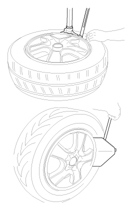

Remoção do Sensor

> **Cuidado**
>
> - Trate o sensor com cuidado.

1. Remova o parafuso do vale.

   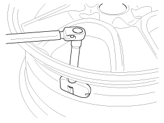

   > **Cuidado**
   >
   > - O parafuso do vale não deve ser reutilizado.

2. Descarte a montagem do vale.

## Instalação

Ajuste do Sensor

> **Cuidado**
>
> - Trate o sensor com cuidado.
> - Evite contato com lubrificante.
> - Assegure-se de que a roda a ser instalada é compatível com o ajuste do sensor. Geralmente deve haver uma marcação para indicar isso.
> - Assegure-se de que a fenda do válvula e a superfície de montagem da roda estejam limpas.

1. Faça passar o conjunto sensor-válvula através da fenda da válvula do
   anel. Apoie o sensor contra o anel e o grommet de borracha contra a superfície de vedação.

2. Insira o parafuso sobre a haste da válvula e, em seguida, aperte o parafuso.

   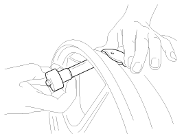

3. Continue a apertar o parafuso até que haja contato com o anel e, em seguida, aperte para 3,5 ~ 4,5Nm.

   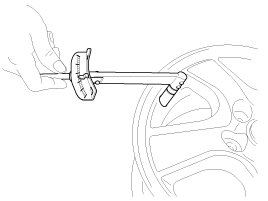

   > **Cuidado**
   >
   > - Ajuste lentamente com passos de ¼ de volta até atingir a torção final.
   > - Não ultrapasse a torção permitida.
   > - Não use ferramentas elétricas ou pneumáticas.

4. Verifique que o sensor está firmemente fixado no anel.

   > **Cuidado**
   >
   > - Risco de danos durante a instalação/remoção da pneumatico se o sensor não estiver firmemente fixado no anel.

5. Realize a inflação/correção de pressão e, em seguida, instale a tampa da válvula.

   > **Cuidado**
   >
   > - Altere o status do sensor recém-instalado para Normal Fixo Base (Baixa Linha) com o "GDS".
   > - O status (configuração / opção) do sensor instalado no veículo deve ser Normal Fixo Base (Baixa).

   [Definir Status do Sensor 1]

   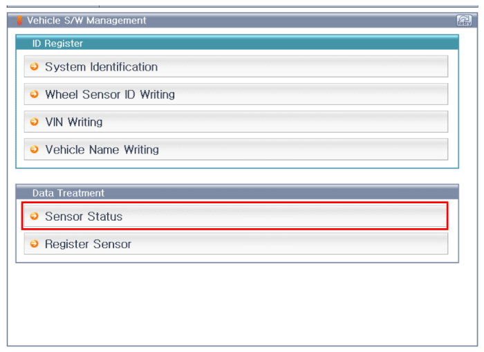

   [Definir Status do Sensor 2]

   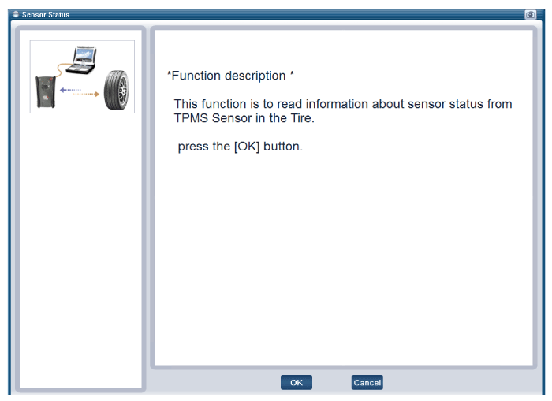

   [Definir Status do Sensor 3]

   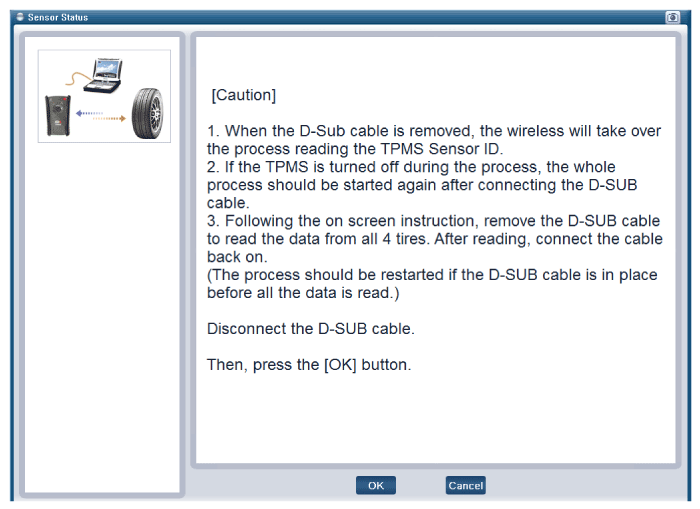

   [Definir Status do Sensor 4]

   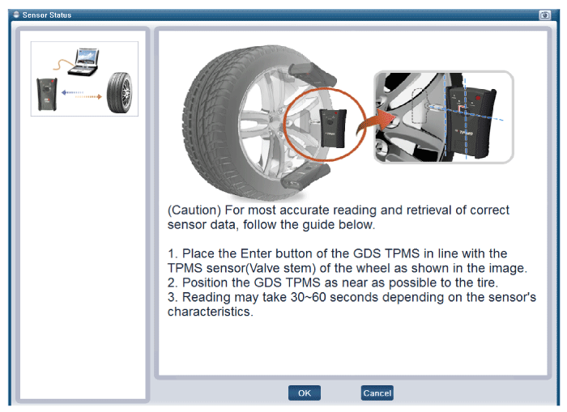

   [Definir Status do Sensor 5]

   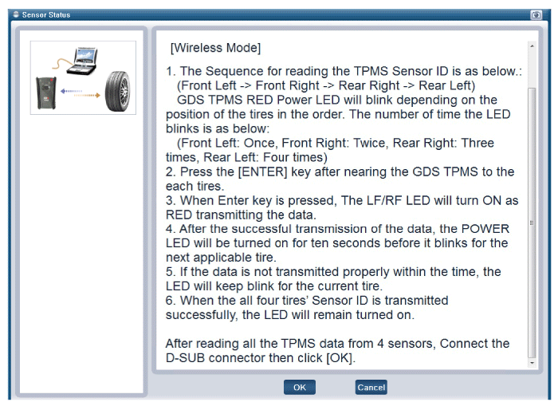

   [Definir Status do Sensor 6]

   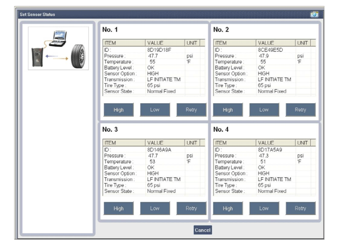

6. Instale o pneumatico. (Consulte "Instalação de Pneumaticos")

7. Em caso de falha do sensor TPMS, o sensor TPMS precisa ser aprendido. Substitua os novos sensores danificados e realize o aprendizado dos sensores TPMS.

[Escrita do ID do Sensor do Eixo (Sem Fio) inicialização]

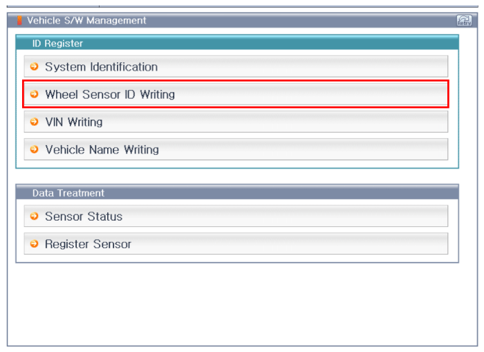

[Escrita do ID do Sensor do Eixo (Sem Fio) 1]

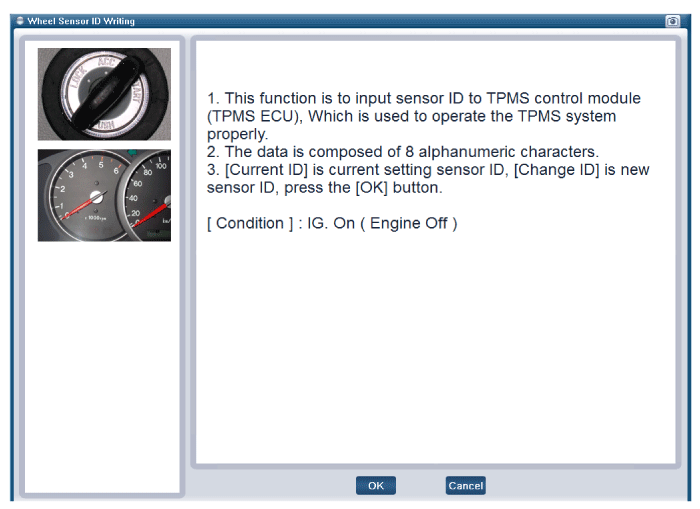

[Escrita do ID do Sensor do Eixo (Sem Fio) 2]

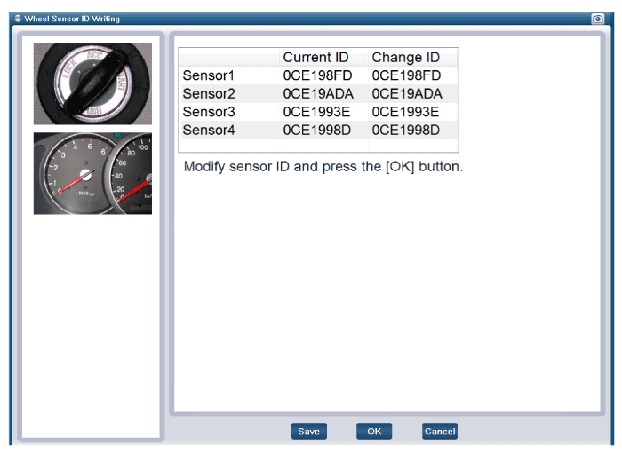

## Procedimento de diagnóstico usando um dispositivo de diagnóstico

O manual para métodos de diagnóstico usando um dispositivo de diagnóstico contém os seguintes conteúdos principais:

1. Conecte o conector de auto-diagnóstico (16 pinos) localizado na parte inferior do painel do lado do motorista ao dispositivo de auto-diagnóstico, e então ligue o dispositivo de auto-diagnóstico após ligar a chave.

2. Selecione o "modelo do veículo" e "TPMS" na tela de seleção de veículo do GDS, e então selecione OK.

[Inicialização do sensor]

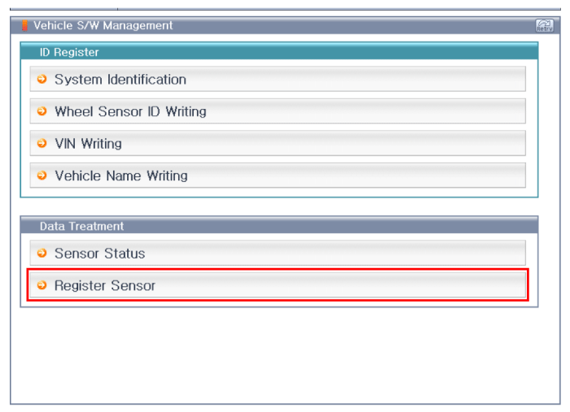

[Descrição da função do sensor]

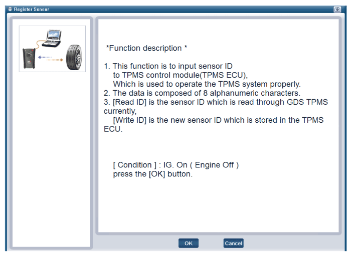

[Fase de preparação - medições do sensor]

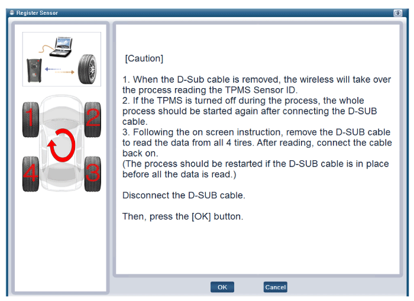

[Método 1 de registro do sensor]

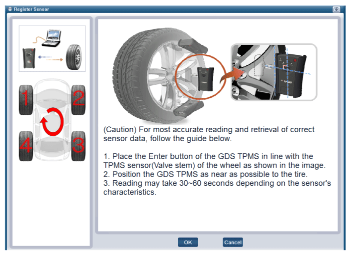

[Método 2 de registro do sensor]

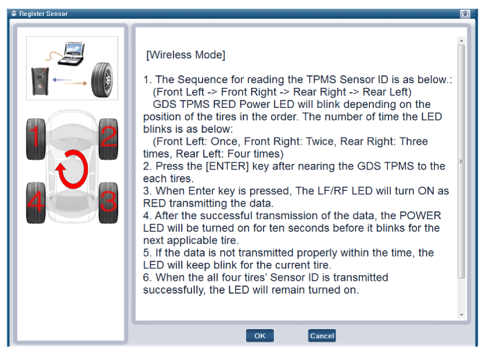

[Método 3 de registro do sensor]

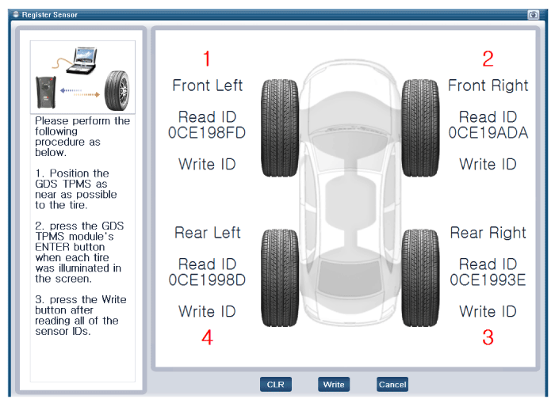

[Método 4 de registro do sensor]

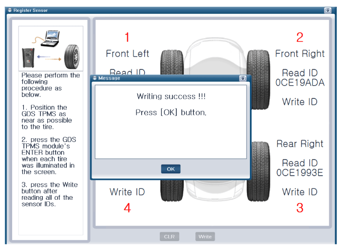

[Método 5 de registro do sensor]

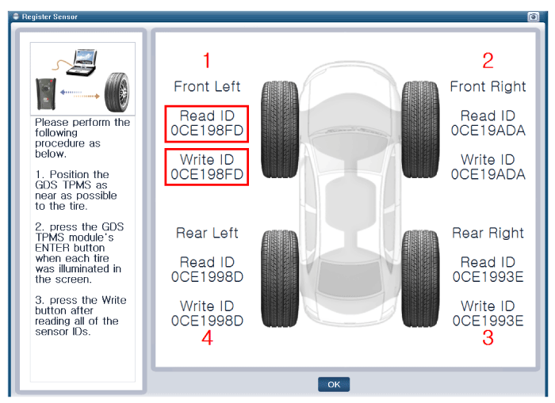

> **Nota**
>
> - Escreva o ID e leia o ID e certifique-se de que eles são iguais.
> - Após o registro bem-sucedido do sensor "Informações do Sensor Sem Fio", verifique se o sensor está funcionando corretamente.
