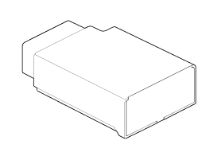

# Kia Sportage: Recebedor do Sistema de Monitoramento de Pressão dos Pneus: Descrição e Operação

[Home](../../index.md) / [Manual de Serviço e Reparo do Kia Sportage SL](../sportage-482.md) / [Sistema de Suspensão](sportage-813.md) / [Sistema de Monitoramento da Pressão dos Pneus](sportage-839.md) / Recebedor do Sistema de Monitoramento de Pressão dos Pneus: Descrição e Operação

## Descrição

1. Modo

   | (1) | Estado Virgem • O recebedor é enviado como único componente neste estado. Peças de substituição devem chegar neste estado. • Neste estado, não há monitoramento de sensor e nem monitoramento de DTC. • Este estado indica que parâmetros específicos da plataforma devem ser escritos no recebedor e que os sensores estão desaprendidos. |
   | --- | --- |
   | • | O recebedor é enviado como único componente neste estado. Peças de substituição devem chegar neste estado. |
   | • | Neste estado, não há monitoramento de sensor e nem monitoramento de DTC. |
   | • | Este estado indica que parâmetros específicos da plataforma devem ser escritos no recebedor e que os sensores estão desaprendidos. |

   | (2) | Estado Normal • Para que o estado de inflação do pneu e o monitoramento de DTC ocorram, o recebedor deve estar neste estado. • Neste estado, o aprendizado automático de sensores está habilitado. |
   | --- | --- |
   | • | Para que o estado de inflação do pneu e o monitoramento de DTC ocorram, o recebedor deve estar neste estado. |
   | • | Neste estado, o aprendizado automático de sensores está habilitado. |

   | (3) | Estado de Teste • Este estado é usado apenas em fábricas de fabricação para verificar a transmissão de RF entre o sensor e o recebedor. |
   | --- | --- |
   | • | Este estado é usado apenas em fábricas de fabricação para verificar a transmissão de RF entre o sensor e o recebedor. |

2. Visão Geral

   | • | Recebe dados RF do sensor. |
   | --- | --- |

   | • | Usa os dados do sensor para decidir se deve acender o Lampada do TREAD. |
   | --- | --- |

   | • | Aprende automaticamente o sensor TPM para monitoramento de sobreaquecimento. |
   | --- | --- |

   | • | Usa as informações do sensor, distância percorrida, níveis de ruído de fundo, status de aprendizado automático, status de saída curto-circuito, nível da bateria do veículo, estados internos do recebedor para determinar se há um problema no sistema ou no veículo. |
   | --- | --- |

## Operação

1. Função Geral

   | • | A aprendizagem automática ocorre apenas uma vez por ciclo de Ignição. |
   | --- | --- |

   | • | Após o sucesso da conclusão, 4 IDs dos sensores dos pneus de rodagem são armazenados na memória para monitoramento. |
   | --- | --- |

   | • | Até que a aprendizagem automática seja concluída, os sensores anteriormente aprendidos são monitorados para avisos de sobrecarga ou vazamento. |
   | --- | --- |

2. Condições Gerais para Aprendizagem de Novos Sensores:

   | • | O receptor deve determinar que está confiante de que o sensor não é temporário: |
   | --- | --- |

   | a. Usa a velocidade do veículo. b. Usa a redução da confiança dos sensores anteriormente aprendidos. | |
   | --- | --- |
   | a. | Usa a velocidade do veículo. |
   | b. | Usa a redução da confiança dos sensores anteriormente aprendidos. |

   | • | O tempo típico para aprender um novo sensor, ao conduzir continuamente a uma velocidade superior a 12,4 mph (20 kph), é de até 20 minutos. |
   | --- | --- |

3. Condições Gerais para Desaprendizagem de um Sensor Removido:

   | • | Leva menos de 20 minutos a uma velocidade entre 12,4 ~ 18,6 mph (20 ~ 30 kph). |
   | --- | --- |

   | • | A redução da confiança depende do tempo que o veículo é conduzido a uma velocidade superior ou igual a 12,4 mph (20 kph). |
   | --- | --- |
