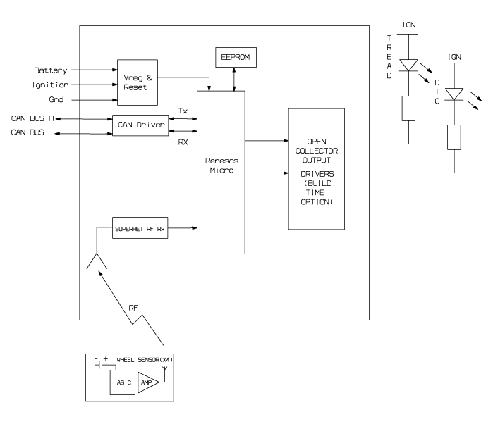

# Kia Sportage: TPMS Receiver: Diagramas Schematicos

[Home](../../index.md) / [Manual de Serviço e Reparo do Kia Sportage SL](../sportage-482.md) / [Sistema de Suspensão](sportage-813.md) / [Sistema de Monitoramento da Pressão dos Pneus](sportage-839.md) / Diagramas Schematicos do TPMS Receiver

## Diagramas Schematicos

Diagrama Circuito do TPMS Receiver

Conector do Acessório

| Pin | Descrição |
| --- | --- |
| 1 | Bateria |
| 2 | CAN_High |
| 3 | GND |
| 4 | - |
| 5 | - |
| 6 | - |
| 7 | IGN |
| 8 | CAN_Low |
| 9 | - |
| 10 | - |
| 11 | - |
| 12 | - |
