# Kia Sportage: TPMS Receiver: Procedimentos de Reparo

[Home](../../index.md) / [Manual de Serviço e Reparo do Kia Sportage SL](../sportage-482.md) / [Sistema de Suspensão](sportage-813.md) / [Sistema de Monitoramento da Pressão dos Pneus](sportage-839.md) / Procedimentos de Reparo do Recebedor TPMS

## Troca

> **Nota**
>
> - Quando o recebedor chegar para troca pela primeira vez:
> - Ele estará em estado de Vírgula.
> - Não estará configurado para nenhum plataforma específica.
> - Não terá nenhum ID de sensor memorizado.

1. Desconecte a bateria do veículo.

2. Remova a garnish do crash pad.

   (Consulte o grupo BD - "Crash Pad")

3. Remova a parte defeituosa e instale a montagem do suporte na nova parte.

   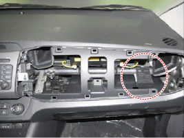

4. Fixe a nova parte ao veículo e conecte o conectador.

5. Reconecte a bateria e ligue o ignição.

6. Após a troca do recebedor, realize a leitura utilizando o dispositivo de diagnóstico (GDS).

## Procedimento de Diagnóstico por Usar Dispositivo de Diagnóstico

Os principais conteúdos para o procedimento de diagnóstico por meio do dispositivo de diagnóstico são os seguintes:

1. Conecte o conectador de diagnóstico (16 pinos) localizado na parte inferior do crash pad do lado do motorista ao dispositivo de diagnóstico, e então ligue o dispositivo de diagnóstico após o chaveamento estiver ON.

2. Selecione o "modelo do veículo" e "TPMS" na tela de seleção de veículo do GDS, e então selecione OK.

[Inicialização do Input do Nome do Veículo]

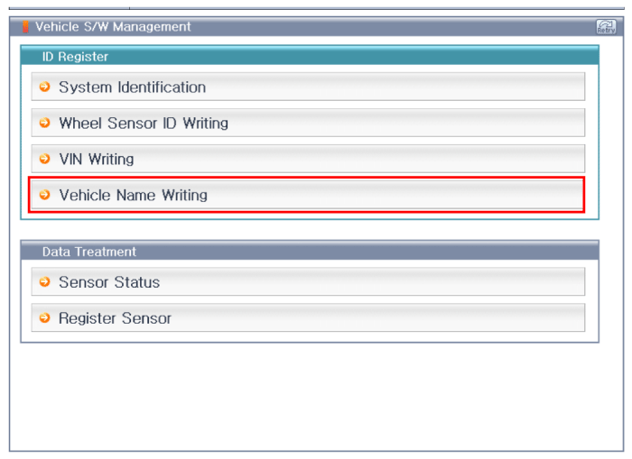

[Metodo 1 de Input do Nome do Veículo]

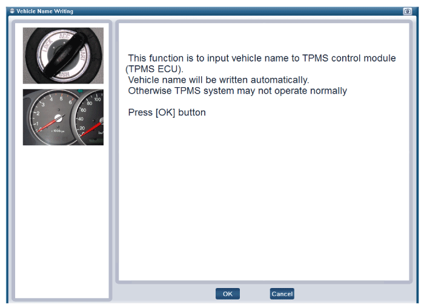

[Metodo 2 de Input do Nome do Veículo]

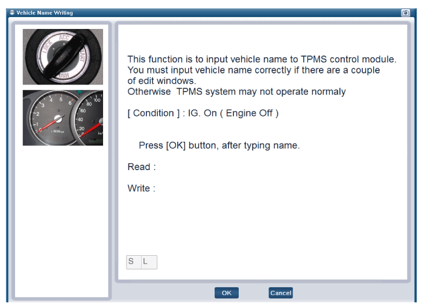

[Metodo 3 de Input do Nome do Veículo]

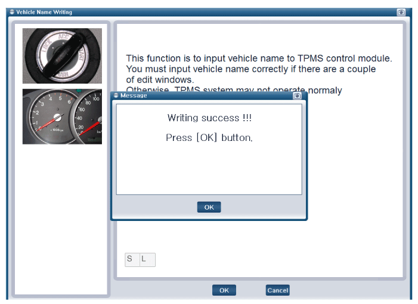

[Inicialização do Input do VIN]

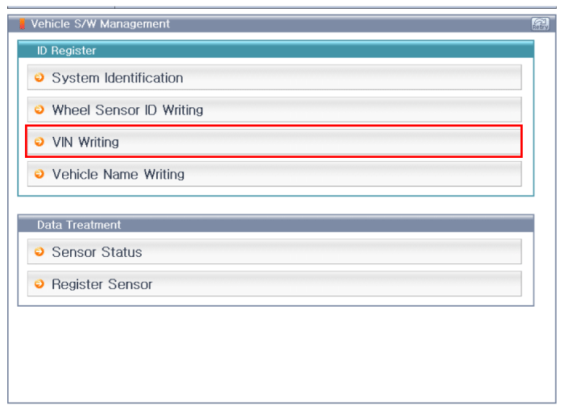

[Metodo 1 de Input do VIN]

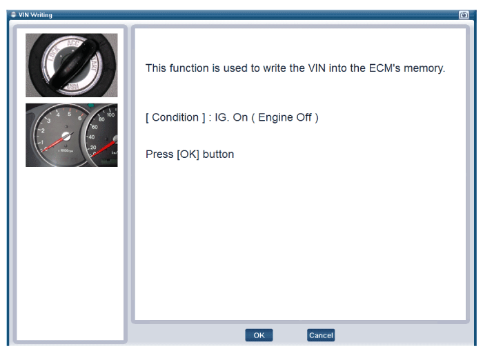

[Metodo 2 de Input do VIN]

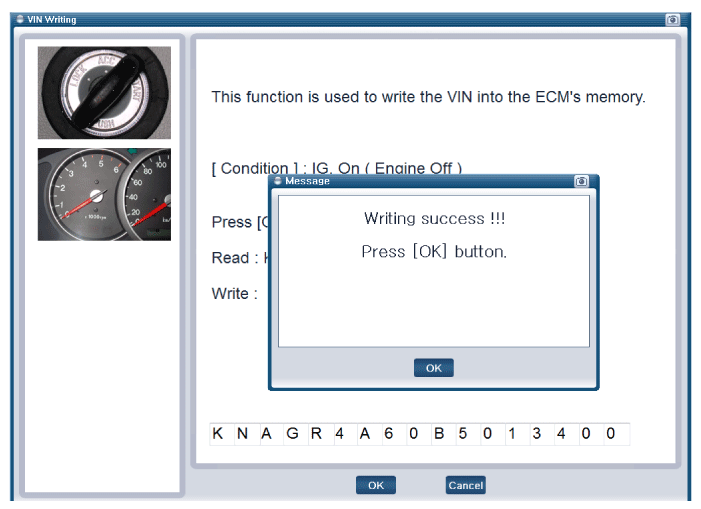

[Configuração do Modo TPMS]

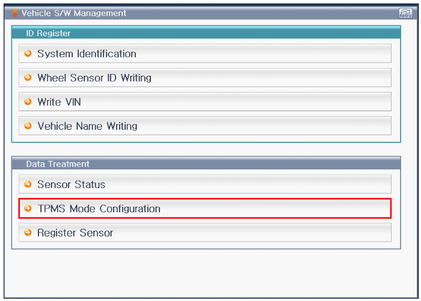

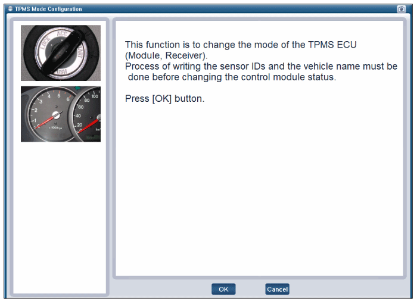

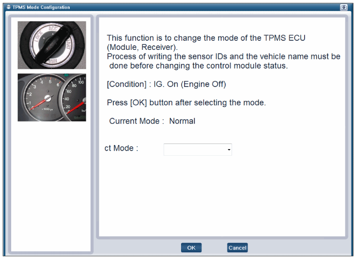

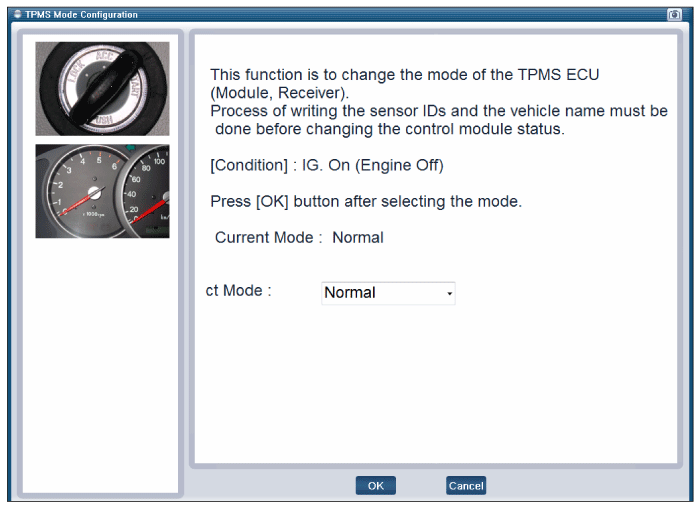

> **Nota**
>
> - Escreva o ID e verifique se o ID lido são os mesmos.
> - Após a注册请登录以继续
