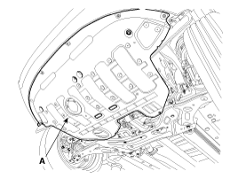
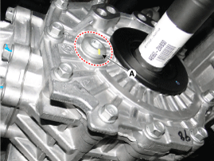
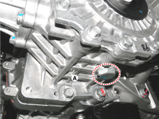

# Kia Sportage: Transfer Fluid: Procedimentos de Reparo

[Home](../../index.md) / [Manual de Serviço e Reparo do Kia Sportage SL](../sportage-482.md) / [Sistema de Tracção Quatro Ruedas (4WD)](sportage-766.md) / [Transfer Assembly](sportage-770.md) / Procedimentos de Reparo do Transfer Fluid

## Inspeção

> **Aviso**
>
> - O óleo de transferência deve ser inspecionado e reabastecido a cada 60.000 km (40.000 milhas) / 4 anos.

1. Remova o capô inferior (A).

   

2. Remova o bocal de enchimento do óleo (A).

   

3. Verifique o nível do óleo.

   > **Aviso**
   >
   > - O nível do óleo deve chegar até preencher o orifício, se não, adicione óleo até que ele transborde.

4. Instale o bocal de enchimento do óleo com nova borracha de vedação.

   ```
   Torque de aperto:
   39,2 ~ 58,8 N.m (4,0 ~ 6,0 kgf.m, 28,9 ~ 43,4 lb-ft)
   ```

5. Instale o capô inferior.

   ```
   Torque de aperto:
   19,6 ~ 24,5 N.m (2,0 ~ 2,5 kgf.m, 14,5 ~ 18,1 lb-ft)
   ```

## Troca

> **Aviso**
>
> - Condições de condução severas
> - Condução em estradas sujas, irregulares
> - Condução em áreas montanhosas
> - Condução de veículos de patrulha, táxi, veículos comerciais ou veículos de tração
> - Condução a mais de 170Km/h
> - * O óleo de transferência deve ser trocado se o assembly de transferência entrar em contato com a água.

1. Remova o capô inferior (A).

   

2. Desloque o bocal de drenagem (A) e derrame o óleo de transferência.

   

3. Instale o bocal de drenagem com nova borracha de vedação.

   ```
   Torque de aperto:
   58,9 ~ 78,5 N.m (6,0 ~ 8,0 kgf.m, 43,4 ~ 57,9 lb-ft)
   ```

4. Remova o bocal de enchimento do óleo (A).

   

5. Adicione novo óleo através do orifício do bocal de enchimento.

   ```
   Óleo padrão:
   SAE 75W/90 API GL-5
   Capacidade do óleo:
   0,6 L (0,16 U.S.gal., 0,63 U.S.qt, 0,53 Imp.qt.)
   ```

   > **Aviso**
   >
   > - Preencha até o nível do fio de vedação do bocal de enchimento.

6. Instale o bocal de enchimento do óleo com nova borracha de vedação.

   ```
   Torque de aperto:
   39,2 ~ 58,8 N.m (4,0 ~ 6,0 kgf.m, 28,9 ~ 43,4 lb-ft)
   ```

7. Instale o capô inferior.

   ```
   Torque de aperto:
   19,6 ~ 24,5 N.m (2,0 ~ 2,5 kgf.m, 14,5 ~ 18,1 lb-ft)
   ```
