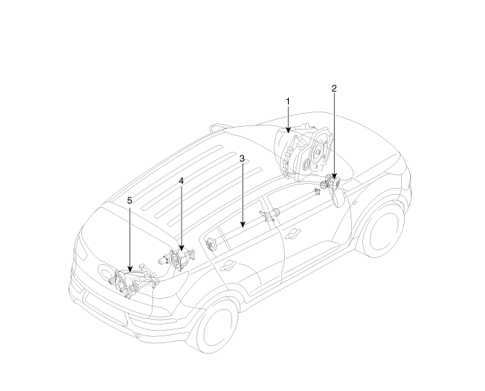

# Kia Sportage: Transferência de Volante da Dianteira: Componentes e Localização dos Componentes

[Home](../../index.md) / [Manual de Serviço e Reparo do Kia Sportage SL](../sportage-482.md) / [Sistema de Tracção nas Quatro Rodas (4WD)](sportage-766.md) / [Transferência de Volante](sportage-770.md) / Componentes e Localização dos Componentes da Transferência de Volante da Dianteira

## Localização dos Componentes

| 1. Caixa de transmissão automática 2. Transferência de volante 3. Eixo propulsor | 4. Conjunto de decalage 5. Conjunto de diferencial |
