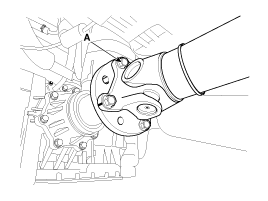
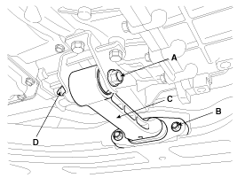
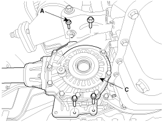
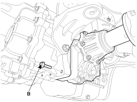

# Kia Sportage: Transferência de Volante da Dianteira: Procedimentos de Reparo

[Home](../../index.md) / [Manual de Serviço e Reparo do Kia Sportage SL](../sportage-482.md) / [Sistema de Tracção Quatro-Rotas (4WD)](sportage-766.md) / [Transferência de Volante](sportage-770.md) / Procedimentos de Reparo da Transferência de Volante da Dianteira

## Remoção

> **Nota**
>
> - Não é recomendado realizar a revisão da transferência de volante
porque é necessário um instrumento de medição tridimensional especial para determinar os tamanhos dos espacadores da transferência quando se desmonta e monta a transferência. Se forem colocados espacadores de tamanho errado na transferência, pode causar ruídos e vibrações. Portanto, se as partes internas da transferência precisarem ser substituídas, a transferência deve ser substituída por uma nova.

1. Elevar o veículo.

2. Remover as varetas de travamento do eixo propulsor. (4 unidades - A)

   ```
   Torque de aperto:
   49,0~68,6N.m (5,0~7,0kgf.m, 36,2~50,6lb-ft)
   ```

   

3. Remover o eixo propulsor (lado passageiro) do caso de transferência. (Consultar "Eixo propulsor" no grupo DS)

4. Remover o suporte do eixo de rolagem (C) após remover as varetas (A, B).

   ```
   Torque de aperto:
   (B) 49,0~63,7N.m (5,0~6,5kgf.m, 36,2~47,0lb-ft)
   (D) 107,9~127,5N.m (11~13kgf.m, 79,6~94,1lb-ft)
   ```

   

5. Remover o subquadro. ("Sistema de suspensão dianteira" no grupo SS)

6. Remover as varetas de montagem do caso de transferência (A - 4 unidades, B - 1 unidade).

   ```
   Torque de aperto:
   (A, B) 60,8~65,7N.m (6,2~6,7kgf.m, 44,8~48,5lb-ft)
   ```

   

   

7. Com o auxílio de um jacto, remover o caso de transferência (C) após suportá-lo com um jacto.

## Montagem

1. A montagem é o inverso da remoção.

   > **Nota**
   >
   > - Cuidado para não danificar o anel de vedação (A). Se o anel de vedação estiver danificado, substitua por um novo.
   > - Aplicar e cobrir as ranhuras (B) com manteiga de molibdênio de alta pressão.
   > - TECHLUBE MEGAMAX - ALFA OU EQUIVALENTE
