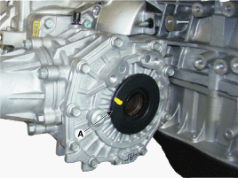
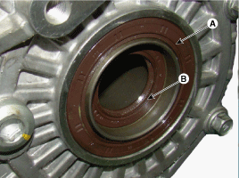
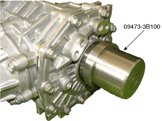
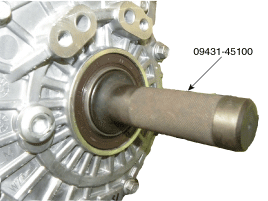
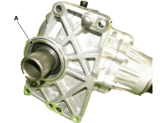
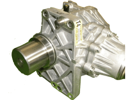

# Kia Sportage: Seal de Óleo: Procedimentos de Reparo

[Home](../../index.md) / [Manual de Serviço e Reparo do Kia Sportage SL](../sportage-482.md) / [Sistema de Quatro Rodas Motrizes (4WD)](sportage-766.md) / [Montagem de Transferência](sportage-770.md) / Procedimentos de Reparo do Seal de Óleo

## Troca

[Parte direita]

1. Remova a montagem do eixo driveshaft. (Lado direito)

   (Consulte "Eixo Driveshaft" em Eixo Driveshaft e Eixo)

2. Remova a cobertura de proteção (A).

   

3. Remova o seal de óleo (A, B).

   

4. Instale o seal de óleo com ferramentas de serviço especiais.

   > **Nota**
   >
   > - Aplicar manteiga à base de lítio entre as bordas do seal.

   

   

5. Instale a nova cobertura de proteção (A).

   

6. Adicione fluido de transferência.

   (Consulte "Fluido de Transferência" em Montagem de Transferência de Quatro Rodas Motrizes desta seção)

7. Instale a montagem do eixo driveshaft. (Lado direito)

   (Consulte "Eixo Driveshaft" em Eixo Driveshaft e Eixo)

[Parte esquerda]

1. Remova a montagem de transferência do transaxle.

   (Consulte "Montagem de Transferência de Quatro Rodas Motrizes" nesta seção)

2. Remova o seal de óleo (A).

   

3. Instale o seal de óleo com ferramentas de serviço especiais (09473-3B100).

   > **Nota**
   >
   > - Aplicar manteiga à base de lítio entre as bordas do seal.

   

4. Adicione fluido de transferência.

   (Consulte "Fluido de Transferência" em Montagem de Transferência de Quatro Rodas Motrizes desta seção)

5. Instale a montagem de transferência.

   (Consulte "Montagem de Transferência de Quatro Rodas Motrizes" nesta seção)
