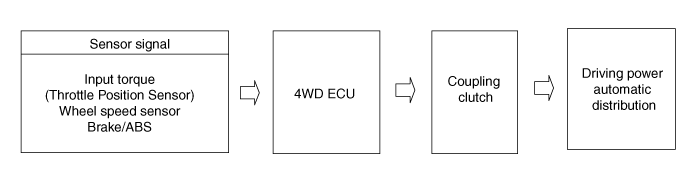

# Kia Sportage: 4WD ECU: Descrição e Operação

[Início](../../index.md) / [Manual de Serviço e Reparo do Kia Sportage SL](../sportage-482.md) / [Sistema de Quatro Rodas Motrizes (4WD)](sportage-766.md) / [Sistema de Controle de Quatro Rodas Motrizes](sportage-775.md) / 4WD ECU: Descrição e Operação

## Descrição

O 4WD ECU processa sinais de diversos sensores e determina as condições atuais de estrada e de condução. Em seguida, o ECU utiliza essa informação para implementar um controle preciso sobre o multiplacaletes do acoplamento 4WD e ajustar variavelmente a quantidade de torque entregue às rodas traseiras.

