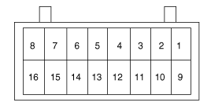
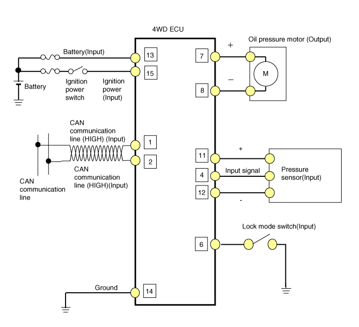

# Kia Sportage: 4WD ECU: Diagramas Schematicos

[Home](../../index.md) / [Manual de Serviço e Reparo do Kia Sportage SL](../sportage-482.md) / [Sistema de Quatro Rodas Motrizes (4WD)](sportage-766.md) / [Sistema de Controle de Quatro Rodas Motrizes](sportage-775.md) / Diagramas Schematicos do 4WD ECU

## Diagrama Schematico

Conector do 4WD ECU

| Pin | Função |
| --- | --- |
| 1 | Motor de pressão do óleo A |
| 2 | Motor de pressão do óleo B |
| 3 | Interruptor de modo de bloqueio |
| 4 | - |
| 5 | Sinal do sensor de entrada(+) |
| 6 | - |
| 7 | Linha de comunicação CAN (Alto) |
| 8 | Linha de comunicação CAN (Baixo) |
| 9 | - |
| 10 | - |
| 11 | - |
| 12 | Poder IG |
| 13 | Terra |
| 14 | Poder da bateria |
| 15 | Sinal do sensor de entrada(-) |
| 16 | Sensor de pressão (Entrada) |
| 17 | - |
| 18 | - |

## Diagrama Schematico do 4WD ECU

