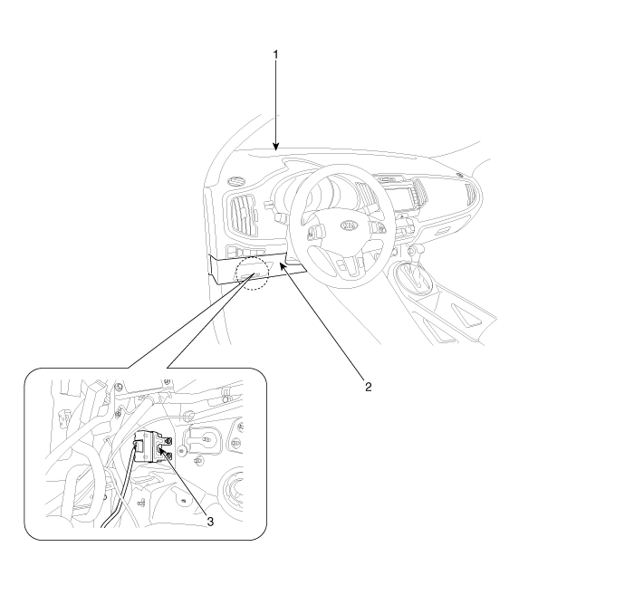

# 4WD ECU — Componentes e localização

[Home](../../index.md) / [Manual de Serviço e Reparo](../sportage-482.md) / [Sistema de Quatro Rodas Motrizes (4WD)](sportage-766.md) / [Sistema de Controle de Quatro Rodas Motrizes (4WD)](sportage-775.md) / Componentes e localização

## Diagrama

## Legenda

| Nº | Componente |
| --- | --- |
| 1 | Pano de crash |
| 2 | Panal inferior de crash |
| 3 | ECU do 4WD |
