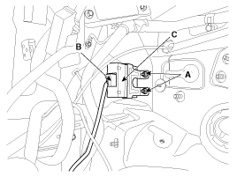

# Kia Sportage: 4WD ECU: Procedimentos de Reparo

[Home](../../index.md) / [Manual de Serviço e Reparo do Kia Sportage SL](../sportage-482.md) / [Sistema de Quatro Rodas Motrizes (4WD)](sportage-766.md) / [Sistema de Controle de Quatro Rodas Motrizes](sportage-775.md) / Procedimentos de Reparo do 4WD ECU

## Troca

> **Cuidado**
>
> - Antes de trocar o 4WD ECU, verifique o acionamento do
clutch do 4WD ECU com a ferramenta GDS. (Consulte "Montagem do acionamento" no grupo 4WD)

1. Remova o painel inferior. (Consulte "Painel de Impacto" no grupo BD)

2. Remova o IPM. (Consulte "Fusíveis e Relés" no grupo BE)

3. Remova o pedal do freio de estacionamento. (Consulte "Sistema de Freio de Estacionamento" no grupo BR)

4. Remova o 4WD ECU (C) após remover o parafuso (A-2ea) e a conexão (B).

   ```
   Torque de aperto:
   9,8 ~ 11,8 N.m (1,0 ~ 1,2 kgf.m, 7,2 ~ 8,7 lb-ft)
   ```

   

5. A instalação é o inverso da remoção.

   > **Cuidado**
   >
   > - Antes de instalar um novo ECU, carregue a leitura do
   acionamento do ECU original para o ECU de substituição usando a ferramenta GDS. (Consulte "Montagem do acionamento" no grupo 4WD)
