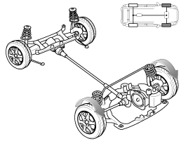
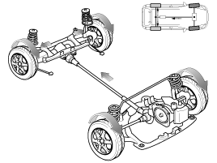
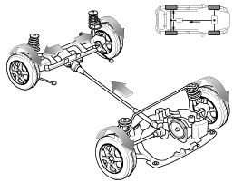
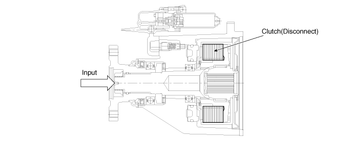
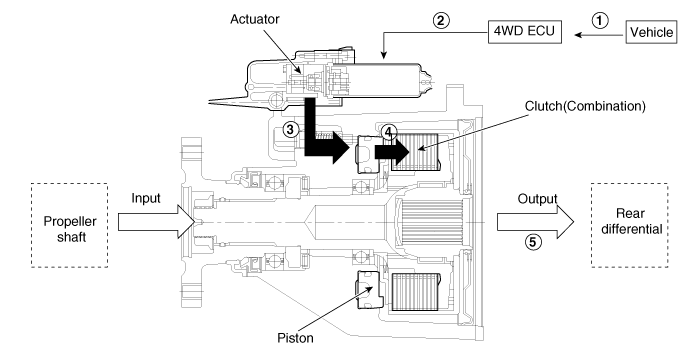

# Kia Sportage: Atuador Hidráulico Elétrico Direto: Descrição e Operação

[Home](../../index.md) / [Manual de Serviço e Reparo do Kia Sportage SL](../sportage-482.md) / [Sistema de Tracção Quatro Rodas (4WD)](sportage-766.md) / [Montagem de Ligação](sportage-781.md) / Atuador Hidráulico Elétrico Direto: Descrição e Operação

## Descrição

O ECU do 4WD processa sinais de diversos sensores e determina as condições atuais de estrada e condução. Em seguida, utiliza essa informação para implementar um controle preciso sobre o multiplacaletes da ligação 4WD e variavelmente ajustar a quantidade de torque entregue às rodas traseiras.

Seleção do Modo de Transferência de Quatro Rodas (4WD)

1. MODE AUTO:

   | – | Ao dirigir em modo 4WD AUTO, o veículo opera de forma semelhante a veículos convencionais 2WD sob condições normais de operação. No entanto, se o sistema determinar que há a necessidade do modo 4WD, a potência do motor é distribuída automaticamente para todas as quatro rodas sem intervenção do condutor. |
   | --- | --- |

   | – | Ao dirigir em estradas normais e pavimentadas, o veículo se move de forma semelhante a veículos convencionais 2WD. |
   | --- | --- |

2. MODE LOCK:

   | – | Este modo é usado para subir ou descer grades acidentadas, dirigir em terrenos off-road, em estradas de areia e lama, etc., para maximizar a tração. |
   | --- | --- |

   | – | Este modo começa automaticamente a desativar acima de 30 km/h (19 mph) e é transferido para o modo 4WD AUTO acima de 40 km/h (25 mph). No entanto, se a velocidade do veículo decelerar para abaixo de 30 km/h (19 mph), o modo de transferência é transferido novamente para o modo 4WD LOCK. |
   | --- | --- |

Controlador Eletrônico de Ligação - Controle do 4WD (Condições de Condução)

1. Cruzeiro (Modo AUTO)

   - A potência é entregue principalmente às rodas dianteiras.

   

2. Curva (Modo AUTO)

   - Ajusta a quantidade de potência entregue às rodas traseiras com base no raio de curva e na velocidade de curva.

   

3. Deslizamento da Roda (Modo AUTO)

   - Se uma ou ambas as rodas dianteiras perderem tração, o sistema transfere uma quantidade apropriada de potência às rodas traseiras com base na quantidade de deslizamento das rodas dianteiras.

   

4. MODE LOCK

   - Maximiza o desempenho em terrenos irregulares (ativo apenas abaixo de 40 km/h).

   

## Operação

Coplificação Elétrica

[Inativa]

[Ativa]

| Ordem de Operação 1. O ECU 4WD recebe sinais CAN dos sensores do veículo. 2. O ECU 4WD calcula a quantidade necessária de torque nas rodas traseiras
e envia o correspondente corrente de controle para o atuador (motor elétrico e bomba hidráulica). 3. A pressão hidráulica gerada pelo atuador move o pistão. 4. A fricção do movimento do pistão engrena o couro de fricção. 5. O poder é entregue às rodas traseiras. |  |
| --- | --- |
| 1. | O ECU 4WD recebe sinais CAN dos sensores do veículo. |
| 2. | O ECU 4WD calcula a quantidade necessária de torque nas rodas traseiras
e envia o correspondente corrente de controle para o atuador (motor elétrico e bomba hidráulica). |
| 3. | A pressão hidráulica gerada pelo atuador move o pistão. |
| 4. | A fricção do movimento do pistão engrena o couro de fricção. |
| 5. | O poder é entregue às rodas traseiras. |
