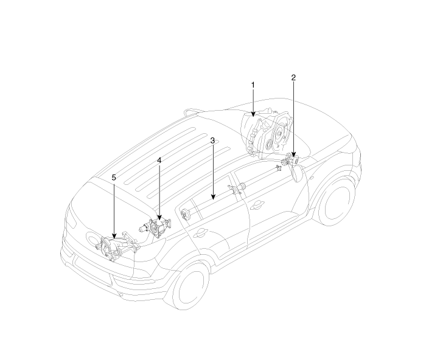
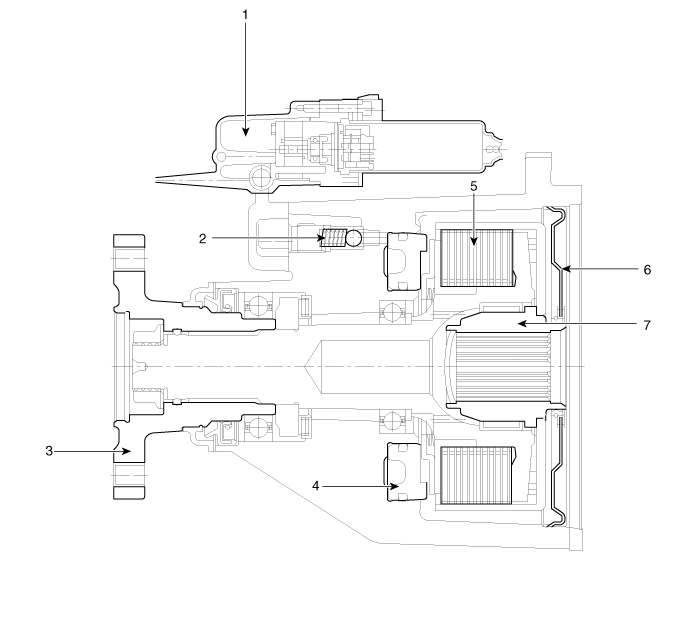

# Kia Sportage: Atuador Hidráulico Eletrônico Direto: Componentes e Localização dos Componentes

[Home](../../index.md) / [Manual de Serviço e Reparo do Kia Sportage SL](../sportage-482.md) / [Sistema de Tracção Quatro Rodas (4WD)](sportage-766.md) / [Montagem de Ligação](sportage-781.md) / Atuador Hidráulico Eletrônico Direto: Componentes e Localização dos Componentes

## Localização dos Componentes

| 1. Caixa de transmissão automática 2. Montagem de transferência 3. Eixo propulsor | 4. Montagem de ligação 5. Montagem diferencial |
| --- | --- |

## Componentes

| 1. Atuador 2. Válvula de descarga 3. Flange & Eixo de entrada 4. Pistão | 5. Conjunto de embreagem 6. Cobertura da vedação de óleo 7. Eixo central |
| --- | --- |
