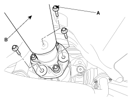
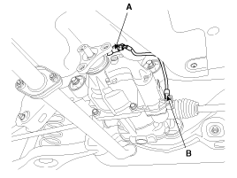
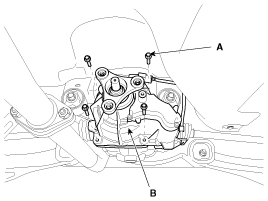

# Kia Sportage: Atuador Hidráulico Eletrônico Direto: Procedimentos de Reparo

[Home](../../index.md) / [Manual de Serviço e Reparo do Kia Sportage SL](../sportage-482.md) / [Sistema de Tracção Quatro Rodas (4WD)](sportage-766.md) / [Montagem](sportage-781.md) / Procedimentos de Reparo do Atuador Hidráulico Eletrônico Direto

## Inspeção

> **Nota**
>
> - Todos os conjuntos estão preenchidos com fluido de ligamento (ATF de baixa viscosidade ultra-baixa) antes do envio. Portanto, a inspeção, o preenchimento e a substituição do fluido de ligamento não são necessários (manutenção zero, fluido para toda a vida).

## Remoção

> **Cuidado**
>
> - Cuidados de Manutenção do Ligamento
> - Mantenha o ligamento em nível horizontal.
> - Consulte o nível de cuidado de manipulação (A) ao servir o ligamento (remoção, instalação, substituição, etc.).
> - Remova a varilha e, em seguida, monte o conjunto de montagem do ligamento no conjunto diferencial traseiro.
> - Mantenha o ligamento em nível horizontal após remover a varilha para prevenir a derramada do fluido.

1. Remova as parafusos (A-3) do conjunto de ligamento do eixo traseiro do propulsor (B).

   ```
   Torque de aperto :
   49,0~68,6N.m (5,0~7,0kgf.m, 36,2~50,6lb-ft)
   ```

   

2. Usando uma ferramenta plana, separe o eixo propulsor do conjunto de ligamento do 4WD.

3. Remova o conectador do freio magnético elétrico (A).

   

4. Remova os parafusos de montagem do conjunto de ligamento do 4WD (A-4).

   ```
   Torque de aperto :
   58,8~63,7N.m (6,0~6,5kgf.m, 43,4~47,0lb-ft)
   ```

   

5. Usando uma ferramenta plana, separe o conjunto de ligamento do 4WD do conjunto carreador do diferencial traseiro.

## Instalação

1. A instalação é o inverso da remoção.

> **Nota**
>
> - Lubrifique a vagem do esmalte (A) do conjunto de ligamento.
> - Lubrifique
> - Graxa Extreme Pressure (EP) contendo sulfeto de molibdênio (MoS2)
> - Ao instalar o ligamento, preste atenção para não danificar a selagem de óleo (B).

> **Cuidado**
>
> - Após a substituição do ligamento, redefina a aprendizagem do freio do ECU 4WD usando a ferramenta GDS. (Consulte "Conjunto de ligamento" no grupo 4WD)

## Ajuste

Descrição

O material de fricção dentro do ligamento se deteriorará com o tempo. Portanto, valores de compensação correspondentes devem ser referenciados e inseridos após a substituição do controlador ou do ligamento.

Requisitos e Procedimentos de Compensação

1. Substituição simultânea do ECU 4WD (Controlador) e do ligamento

   | – | Não requer compensação. |
   | --- | --- |

2. Substituição apenas do ligamento

   | – | Redefina a aprendizagem do freio do ECU 4WD (Controlador). |
   | --- | --- |

3. Substituição apenas do ECU 4WD (Controlador)

   | – | Antes da substituição: Verifique a aprendizagem do ECU. |
   | --- | --- |

   | – | Após a substituição: Insira a aprendizagem original do ECU na nova unidade de ECU. |
   | --- | --- |
