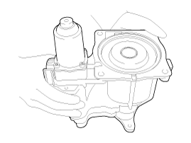

# Kia Sportage: Motor Hidráulico do Motor (Atuador): Descrição e Operação

[Home](../../index.md) / [Manual de Serviço e Reparo do Kia Sportage SL](../sportage-482.md) / [Sistema de Tracção Quatro-Rodas (4WD)](sportage-766.md) / [Montagem do Conjunto](sportage-781.md) / Motor Hidráulico do Motor (Atuador): Descrição e Operação

## Descrição

O ECM do 4WD controla o Motor Bomba Bomba (Atuador) para gerar uma pressão de óleo. Essa pressão engata um travamento com disco múltiplo, transferindo torção para as rodas traseiras. A torção para as rodas traseiras varia de acordo com a pressão no travamento.

