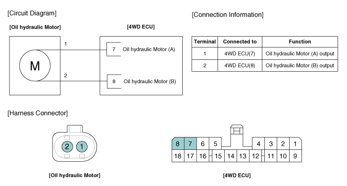

# Kia Sportage: Motor Hidráulico de Óleo (Atuador): Diagramas Schematicos

[Home](../../index.md) / [Manual de Serviço e Reparo do Kia Sportage SL](../sportage-482.md) / [Sistema de Tracção Quatro Rádios (4WD)](sportage-766.md) / [Montagem de Ligação](sportage-781.md) / Diagramas Schematicos do Motor Hidráulico de Óleo (Atuador)

## Diagrama Circuito

