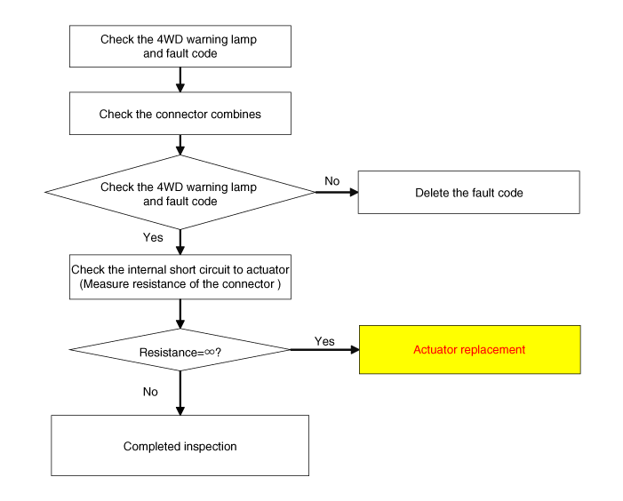
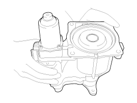
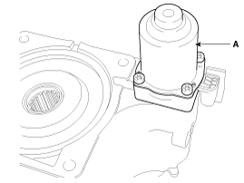
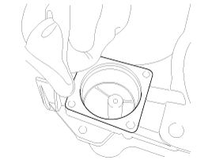
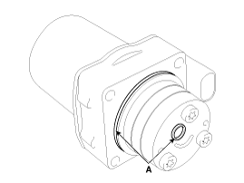
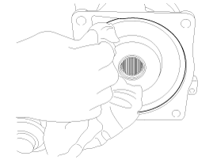

# Kia Sportage: Motor Hidráulico do Motor (Atuador): Procedimentos de Reparo

[Home](../../index.md) / [Manual de Serviço e Reparo do Kia Sportage SL](../sportage-482.md) / [Sistema de Tracção Quatro Rodas (4WD)](sportage-766.md) / [Montagem de Ligação](sportage-781.md) / Procedimentos de Reparo do Motor Hidráulico do Motor (Atuador)

## Inspeção

> **Nota**
>
> - Se você tiver um código de falha relacionado ao motor hidráulico do motor (atuador) (P1825, P1826, P1827, P1828), inspecione o motor hidráulico do motor (atuador) de acordo com o processo de inspeção.

Procedimento de Inspeção do Motor Hidráulico do Motor (Atuador)



## Remoção

1. Remova a montagem de ligação.

   (Consulte a montagem de ligação no grupo 4WD)

2. Mantenha o estado perpendicular após remover a montagem de ligação.

   > **Nota**
   >
   > - Ao remover o motor hidráulico da montagem de ligação, assegure-se de que o motor hidráulico permaneça vertical em relação ao nível da mesa de trabalho ou ao solo, conforme mostrado na imagem abaixo, para evitar que o óleo da montagem de ligação escorra. Se o óleo da montagem de ligação escorrer do motor hidráulico ou da montagem de ligação, substitua a montagem de ligação por uma nova. (Não recomendamos adicionar ou alterar o óleo da montagem de ligação, pois a especificação e a proporção de preenchimento do óleo da montagem de ligação afetam significativamente o desempenho e a durabilidade da montagem de ligação.)

   

3. Remova o motor hidráulico (atuador) após desafinar os parafusos com uma chave hexagonal.

   > **Cautela**
   >
   > - Remova o motor hidráulico (atuador) após derramar o óleo residual dentro da montagem de ligação o máximo possível (aproximadamente 5~10 segundos).

   

## Instalação

1. Antes da instalação, limpe a superfície com uma gaze limpa.

   

2. Verifique os anéis O dos novos motores hidráulicos (acionadores).

   

   > **Cuidado**
   >
   > - Você deve prevenir a entrada de poeira nos motores hidráulicos (acionadores) e no casco.

3. Ajuste os parafusos após a instalação dos motores hidráulicos (acionadores).

   > **Cuidado**
   >
   > - Durante a instalação, o conectador do motor deve apontar para fora do couplador.

   ```
   Torque de aperto:
   8,8 ~ 10,8 N.m (0,9 ~ 1,1 kgf.m, 6,5 ~ 8,0 lb-ft)
   ```

   

   > **Nota**
   >
   > - Durante a instalação, o óleo pode retornar pela pressão na válvula de respiração do ar (peso do óleo refluxado: aproximadamente 5 ~ 10ml).
   > - Altere a direção na direção do setor e coloque no chão conforme ilustrado.
   > - ? O óleo refluxado fluirá para o fundo.
   > - Você deve prevenir a refluxo adicional conforme a ordem ilustrada.

4. Limpe a superfície com uma gaze limpa onde o óleo fluía.

   

5. Mede o peso do couplador.

   ```
   Peso da montagem do couplador:
   8,18 ~ 8,23kg (Capacidade atual de óleo 490ml)
   ```

   > **Cuidado**
   >
   > - Se o peso do couplador montado for inferior a 8,18kg,
   deve-se substituir a montagem do couplador devido ao suspeito de refluxo excessivo.
