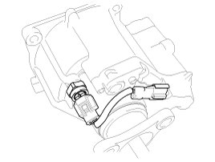

# Kia Sportage: Sensor de Pressão: Descrição e Operação

[Home](../../index.md) / [Manual de Serviço e Reparo do Kia Sportage SL](../sportage-482.md) / [Sistema de Tracção Total (4WD)](sportage-766.md) / [Montagem do Conjunto de Ligação](sportage-781.md) / Sensor de Pressão: Descrição e Operação

## Descrição

O ECU do 4WD faz um Bomba Motor (Atuador) girar para gerar uma pressão de óleo. Em seguida, pressiona um conjunto de disco múltiplo e transfere o torque gerado para as rodas traseiras. O valor de torque varia de acordo com o status de pressão.

