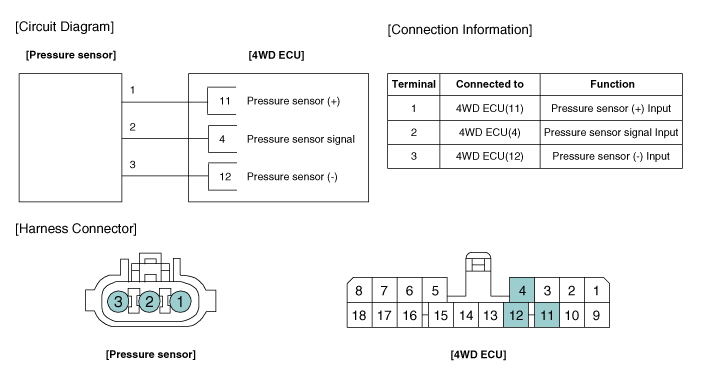

# Kia Sportage: Sensor de Pressão: Diagramas Schematicos

[Home](../../index.md) / [Manual de Serviço e Reparo do Kia Sportage SL](../sportage-482.md) / [Sistema de Tracção Total (4WD)](sportage-766.md) / [Montagem do Ligamento](sportage-781.md) / Diagramas Schematicos do Sensor de Pressão

## Diagrama Elétrico

