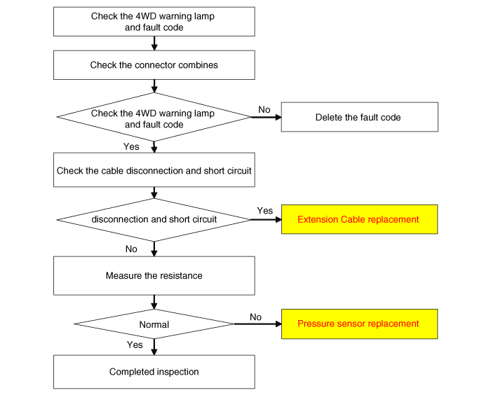
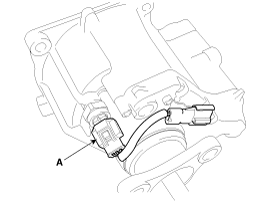
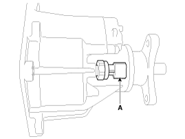

# Kia Sportage: Sensor de Pressão: Procedimentos de Reparo

[Home](../../index.md) / [Manual de Serviço e Reparo do Kia Sportage SL](../sportage-482.md) / [Sistema de Tracção Quatro Rodas (4WD)](sportage-766.md) / [Montagem do Conjunto](sportage-781.md) / Procedimentos de Reparo do Sensor de Pressão

## Inspeção

> **Nota**
>
> - Se você tiver um código de falha relacionado ao sensor de pressão (P1825, P1826, P1827, P1828), verifique o sensor de pressão de acordo com o processo de inspeção.

Procedimento de Inspeção do Sensor de Pressão



Medir a resistência do sensor de pressão

1. Desligue o interruptor de ignição.

2. Desconecte o conector do sensor de pressão.

3. Medir a resistência entre o terminal do sensor e o terminal.

4. Verifique a resistência medida. (Consulte a tabela)

   | Terminal | Resistência |
   | --- | --- |
   | PIN 2 – PIN 3 | 2,755 ~ 4,133 k? |
   | PIN 1 – PIN 3 | 1,892 ~ 2,838 k? |
   | PIN 1 – PIN 2 | 1,714 ~ 2,838 k? |

## Remoção

1. Remova o conjunto do montagem.

   (Consulte o "conjunto do montagem" no grupo 4WD)

2. Remova o cabo de extensão (A).

   

3. Remova o sensor de pressão (A) com chave de 24mm.

   > **Cuidado**
   >
   > - Mantenha o estado horizontal para prevenir vazamentos durante a remoção do sensor de pressão.

   ```
   Torque de aperto:
   7,8 ~ 9,8 N.m (0,8 ~ 1,0kgf.m, 5,8 ~ 7,2 lb-ft)
   ```

   

## Instalação

> **Cuidado**
>
> - Verifique a limpeza do sensor de pressão antes da instalação.
> - Verifique o anel de vedação do sensor de pressão (A).

1. A instalação é o inverso da remoção.
