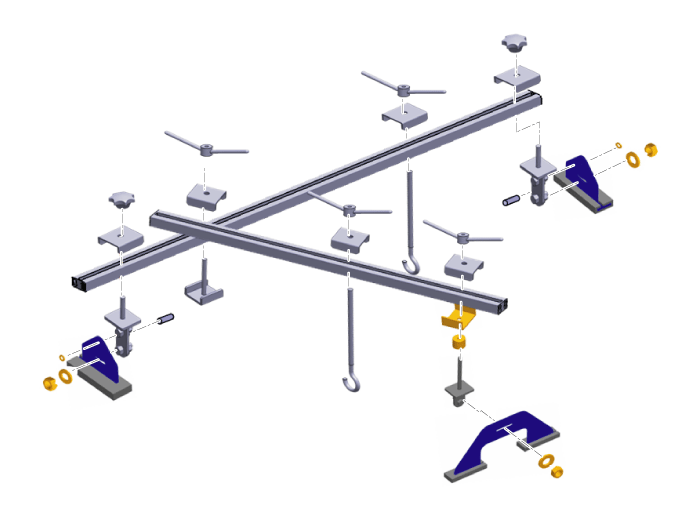

# Kia Sportage: Ferramentas Especiais de Serviço

[Home](../../index.md) / [Manual de Serviço e Reparo do Kia Sportage SL](../sportage-482.md) / [Sistema de Transaxle Automático](sportage-683.md) / Ferramentas Especiais de Serviço

## Ferramentas Especiais de Serviço

| Nome / Número da Ferramenta | Ilustração | Descrição |
| --- | --- | --- |
| Aparador de motor (barra) 09200-3N000 |  | Usado para segurar a montagem do motor ao remover / instalar a transaxle Usado com o suporte (09200-2S000) |
| Aparador de motor (suporte) A: 09200-2S000 B: 09200-2S100 C: 09200-2S200 |  | Usado para segurar a montagem do motor ao remover / instalar a transaxle Usado com a barra (09200-3N000) |
| Instalador de selo de óleo A: 09453-3L240 (Instalador) B: 09231-H1100 (Manivela) |  | Usado para instalar o selo de óleo do lado do motor em caso de veículo com tração traseira Usado para instalar o selo de óleo do lado da caixa de transmissão em caso de veículo com tração integral |
| Instalador de selo de óleo A:09453-2W100 (Instalador) B: 09231-H1100 (Manivela) |  | Usado para instalar o selo de óleo do lado do casco do convertor em caso de veículo com tração integral |
| Pincoleta de interruptor de inibidor 09480-A3800 |  | ? |

? Desenho de montagem da ferramenta especial de suporte do motor

