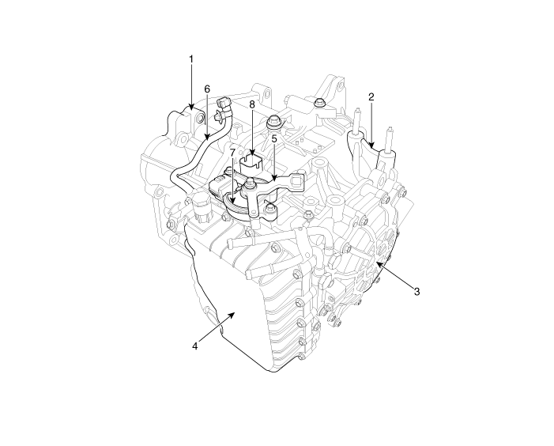

# Kia Sportage: Caixa Automática: Componentes e Localização dos Componentes

[Home](../../index.md) / [Manual de Serviço e Reparo do Kia Sportage SL](../sportage-482.md) / [Sistema de Caixa Automática](sportage-683.md) / [Caixa Automática](sportage-687.md) / Componentes da Caixa Automática e Localização dos Componentes

## Localização dos Componentes

| 1. Caixa de Conversor 2. Caixa de Transmissão Automática 3. Cobertura da Carcaça Traseira 4. Cobertura do Corpo do Valvulário | 5. Manivela Manual 6. Tubo de Respiração do Ar 7. Interruptor de Inhibidor 8. Conector do Valvulário Solenóide |
| --- | --- |
