# Kia Sportage: Transmissão Automática: Procedimentos de Reparo

[Home](../../index.md) / [Manual de Serviço e Reparo do Kia Sportage SL](../sportage-482.md) / [Sistema de Transmissão Automática](sportage-683.md) / [Procedimentos de Reparo da Transmissão Automática](sportage-687.md) / Procedimentos de Reparo da Transmissão Automática

## Remoção

1. Remova os seguintes itens;

   | • | Cobertura do motor (A). |
   | --- | --- |

   | • | Montagem do limpador de ar e tubo de ar (B). (Consulte o "Sistema de Admissão e Exaustão" no grupo EM.) |
   | --- | --- |

   | • | Bateria e suporte da bateria (C). (Consulte o "Sistema de Carregamento" no grupo EE.) |
   | --- | --- |

   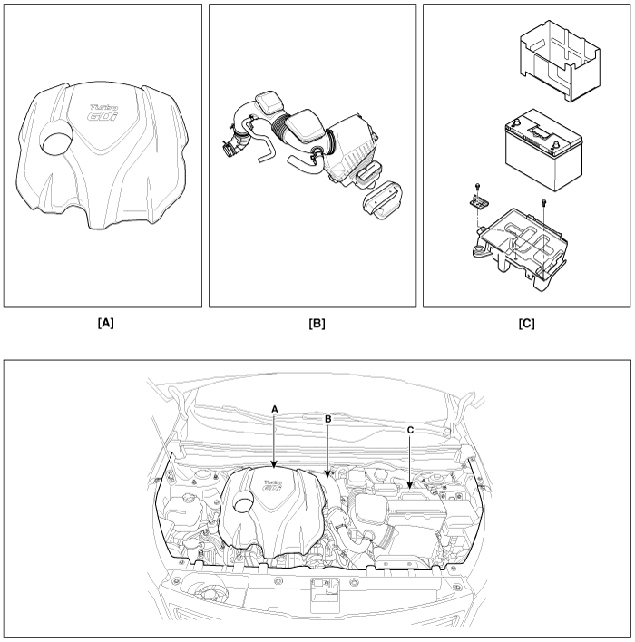

2. Remova a linha de terra após remover o parafuso (A).

   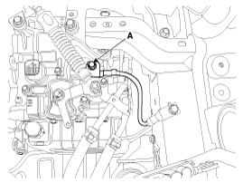

3. Desconecte o conector do válvulo solenoide (A) e o conector do interruptor de inibidor (B).

   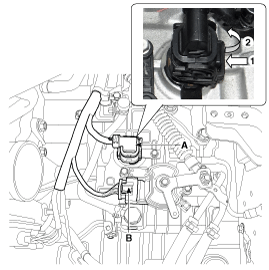

4. Remova o cabo de controle (C) após remover o parafuso (A) e o parafuso (B).

   ```
   Torque de aperto:
   (A) 9,8 ~ 13,7 N.m (1,0 ~ 1,4 kgf.m, 7,2 ~ 10,1 lb-ft)
   (B) 14,7 ~ 21,6 N.m (1,5 ~ 2,2 kgf.m, 10,9 ~ 15,9 lb-ft)
   ```

   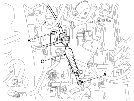

5. Remova o suporte de montagem do conector do válvulo solenoide e do conector do interruptor de inibidor (A).

   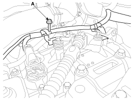

6. Desconecte o mangote (B) após remover o alça do mangote do resfriador de líquido transmissor (A).

   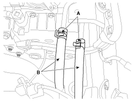

7. Remova o parafuso de montagem do suporte de montagem (A).

   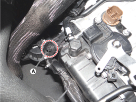

8. Remova os parafusos de montagem do transmissor superior (A-2ea) e os parafusos de montagem do motor starter (B-2ea).

   ```
   Torque de aperto:
   (A) 42,2 ~ 54,0 N.m (4,3 ~ 5,5 kgf.m, 31,1 ~ 39,8 lb-ft)
   (B) 49,0 ~ 63,7 N.m (5,0 ~ 6,5 kgf.m, 36,2 ~ 47,0 lb-ft)
   ```

   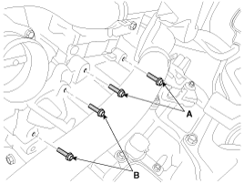

9. Remova a cobertura do cowl.

   (Consulte o "Interior (cobertura do cowl)" no grupo BD.)

10. Remova o motor de limpador.

    (Consulte o "Motor de limpador de vidro" no grupo BE.)

11. Remova o painel de montagem do cowl completo (A).

    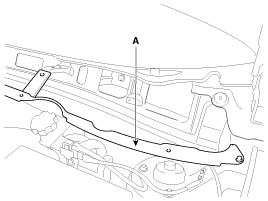

12. Usando a ferramenta de suporte do motor (Support SST No.:
    09200-2S000, Bar SST No.: 09200-3N000), segure o conjunto do motor e transmissor de forma segura.

    (Consulte o "Desenho da ferramenta de suporte do motor especial" no grupo Geral desta seção)

    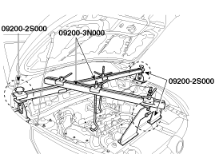

13. Remova a cobertura (A).

    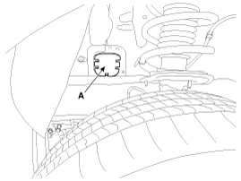

14. Remova os parafusos de montagem do suporte do transmissor (A).

    ```
    Torque de aperto:
    88,3 ~ 107,9 N.m (9,0 ~ 11,0 kgf.m, 65,1 ~ 79,8 lb-ft)
    ```

    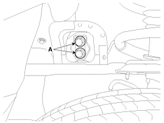

15. Remova o suporte do transmissor de montagem (C).

    ```
    Torque de aperto:
    (A) 78,5 ~ 98,1 N.m (8,0 ~ 10,0 kgf.m, 57,9 ~ 72,3 lb-ft)
    (B) 58,9 ~ 78,5 N.m (6,0 ~ 8,0 kgf.m, 43,4 ~ 57,9 lb-ft)
    ```

    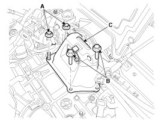

16. Levante o veículo com um jacto.

17. Remova a cobertura inferior (A).

    ```
    Torque de aperto:
    19,6 ~ 24,5 N.m (2,0 ~ 2,5 kgf.m, 14,5 ~ 18,1 lb-ft)
    ```

    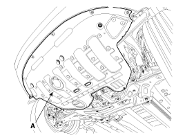

18. Remova a cobertura lateral (A).

    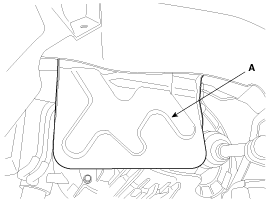

19. Remova o suporte do eixo rolante (C) após remover o parafuso (A, B).

    ```
    Torque de aperto:
    ```

(A) 107,9 ~ 127,5 N.m (11,0 ~ 13,0 kgf.m, 79,6 ~ 94,1 lb-ft)
(B) 49,0 ~ 63,7 N.m (5,0 ~ 6,5 kgf.m, 36,2 ~ 47,0 lb-ft)

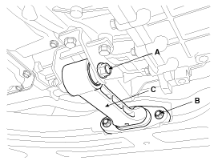

20. Remova a bomba de vácuo (A).

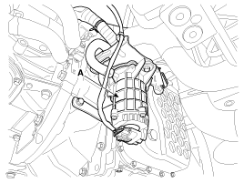

21. Remova os seguintes itens;

2WD

| • | Conjunto de eixo drive (Consulte "Conjunto de eixo drive" no grupo DS.) |
| --- | --- |

4WD

| • | Conjunto de eixo drive (Consulte "Conjunto de eixo drive" no grupo DS.) |
| --- | --- |

| • | Conjunto de sub quadro (Consulte "Sistema de suspensão dianteira" no grupo SS.) |
| --- | --- |

| • | Conjunto de transferência (Consulte "Conjunto de transferência" no grupo WD.) |
| --- | --- |

22. Remova a capa de proteção (A).

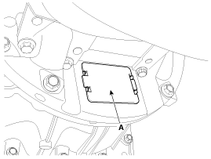

23. Remova os parafusos de montagem do conversor de torque (A-6ea) girando o eixo do pistão.

```
Torque de aperto:
45,1 ~ 52,0 N.m (4,6 ~ 5,3 kgf.m, 33,3 ~ 38,3 lb-ft)
```

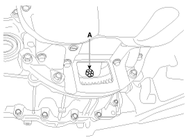

24. Remova a caixa de transmissão automática com um suporte após remover os parafusos de montagem (A-4ea, B-2ea).

```
Torque de aperto:
(A) 42,2 ~ 48,1 N.m (4,3 ~ 4,9 kgf.m, 31,1 ~ 35,4 lb-ft)
(B) 42,2 ~ 54,0 N.m (4,3 ~ 5,5 kgf.m, 31,1 ~ 39,8 lb-ft)
```

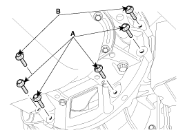

## Instalação

1. Instale na ordem inversa à remoção.

   > **Nota**
   >
   > - No caso de reinstalação,
   > - Substitua a selagem do óleo por uma nova, utilizando uma ferramenta especial, caso ocorra vazamento de ATF devido ao dano na selagem do diferencial.
   > - Verifique o nível de ATF após a reposição do transmissor automático com fluido.
   > - (Consulte "Fluido" no Sistema Hidráulico deste grupo)
   > - Limpe os códigos de diagnóstico (DTC) usando o GDS.
   > - (Os DTCs não serão limpos mesmo após a desconexao do terminal negativo da bateria. Portanto, certifique-se de limpar os DTCs usando o GDS.)
   > - No caso de substituição por um novo transmissor automático,
   > - O novo transmissor automático já está preenchido com a quantidade especificada de ATF.
   > - Por isso, não é necessário refilhar e verificar o ATF, no entanto, o ATF residual no cooler do ATF deve ser removido.
   > - Instale o transmissor após remover o ATF residual sopando ar no hose do cooler do ATF.
   > - Resete os valores adaptativos do transmissor automático usando o GDS.
   > - Execute o procedimento de aprendizado de valores adaptativos do TCM.
   > - (Consulte "Procedimentos de reparo" no Sistema de Controle do Transmissor Automático deste grupo)
   > - No caso de substituição por um transmissor automático remanufaturado,
   > - O transmissor automático remanufaturado não está preenchido com a quantidade especificada de ATF.
   > - Por isso, é necessário refilhar e verificar o ATF.
   > - (Os DTCs não serão limpos mesmo após a desconexao do terminal negativo da bateria. Portanto, certifique-se de limpar os DTCs usando o GDS.)
