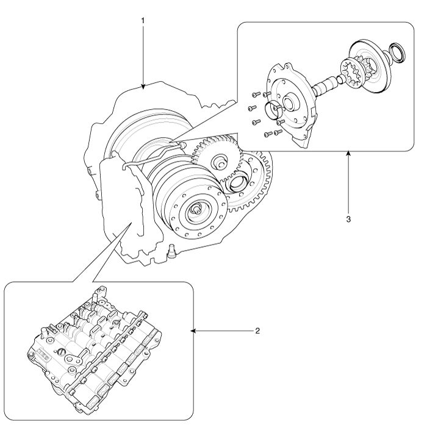

# Sistema Hidráulico — Componentes e localização

[Home](../../index.md) / [Manual de Serviço e Reparo](../sportage-482.md) / [Sistema de Transaxle Automático](sportage-683.md) / [Sistema Hidráulico](sportage-690.md) / Componentes e localização

## Diagrama

## Legenda

| Nº | Componente |
| --- | --- |
| 1 | Transaxle automático |
| 2 | Montagem do corpo de válvulas |
| 3 | Montagem do bomba de óleo |
