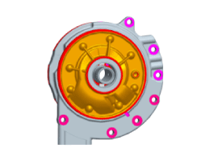

# Kia Sportage: Bomba de Óleo: Descrição e Operação

[Home](../../index.md) / [Manual de Serviço e Reparo do Kia Sportage SL](../sportage-482.md) / [Sistema de Transaxle Automático](sportage-683.md) / [Sistema Hidráulico](sportage-690.md) / Bomba de Óleo: Descrição e Operação

## Descrição

A bomba de óleo é integrada como uma unidade única com a câmara de freio 26. A rotação da bomba gera a pressão hidráulica necessária para a lubrificação das diversas partes do transaxle e para a operação do freio e da embreagem. O óleo também circula através do conversor de torque e do resfriador.

