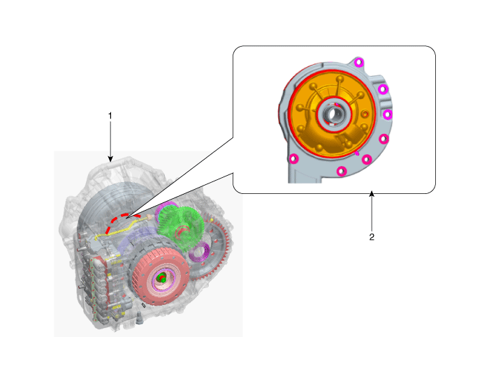
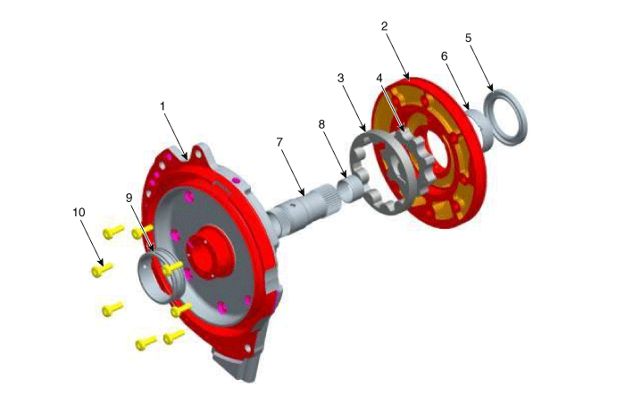
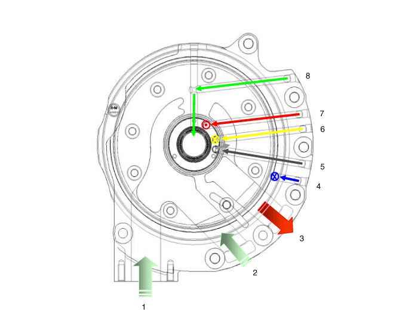

# Kia Sportage: Bomba de Óleo: Componentes e Localização dos Componentes

[Home](../../index.md) / [Manual de Serviço e Reparo do Kia Sportage SL](../sportage-482.md) / [Sistema de Transaxle Automático](sportage-683.md) / [Sistema Hidráulico](sportage-690.md) / Componentes e Localização da Bomba de Óleo

## Localização dos Componentes

| 1. Transaxle Automático 2. Montagem da Bomba de Óleo |  |
| --- | --- |

## Componente

| 1. Montagem de Suporte do Eixo Reativo 2. Caixa da Bomba de Óleo 3. Engrenagem Dirigida 4. Engrenagem Dirigindo 5. Selo de Óleo | 6. Bush-Housing 7. Eixo Reativo 8. Bush-Eixo Reativo 9. Cilindro 10. Parafuso de Flanque |
| --- | --- |

Fluxo de Operação da Bomba de Óleo

| 1. Inalação (Filtro de Óleo) 2. Inalação (Corpo do Valvulário) 3. Saída 4. Pressão de Operação 26/B | 5. Pressão de Operação 35R/C 6. Lubrificação 7. Operação do Cinto de Bloqueio 8. Cancelamento do Cinto de Bloqueio |
| --- | --- |
