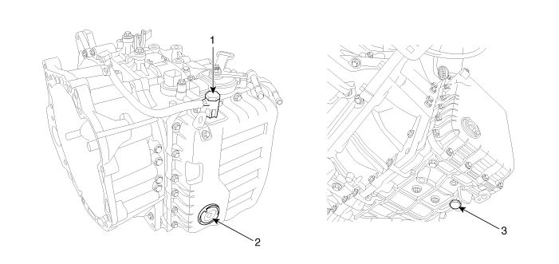

# Kia Sportage: Fluid: Componentes e Localização dos Componentes

[Home](../../index.md) / [Manual de Serviço e Reparo do Kia Sportage SL](../sportage-482.md) / [Sistema de Transaxle Automático](sportage-683.md) / [Sistema Hidráulico](sportage-690.md) / Fluido: Componentes e Localização dos Componentes

## Localização dos Componentes

1. Furo de injecção (parafuso de olho) 2. Fita do nível do óleo 3. Fita do dreno do óleo
