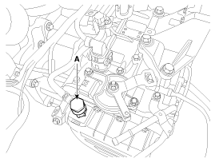
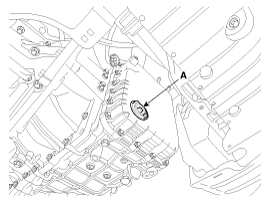
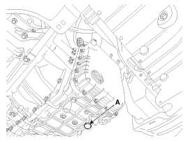

# Kia Sportage: Fluid: Procedimentos de Reparo

[Home](../../index.md) / [Manual de Serviço e Reparo do Kia Sportage SL](../sportage-482.md) / [Sistema de Transaxle Automático](sportage-683.md) / [Sistema Hidráulico](sportage-690.md) / Procedimentos de Reparo do Fluido

## Procedimento de Ajuste de Serviço

Verificação do Nível de Óleo

> **Cuidado**
>
> - Ao verificar o nível de óleo, tenha cuidado para não entrar poeira, resíduos, etc. pelo orifício de enchimento.

1. Remova o parafuso de olho (A).

   ```
   Torque de aperto do parafuso de olho:
   2,9 ~ 4,9 N.m (0,3 ~ 0,5 kgf.m, 2,2 ~ 3,6 lb-ft)
   ```

2. Adicione 700cc de ATF SP-IV pela entrada de ATF.

   

3. Inicie o motor. (Não pisque no freio e no acelerador ao mesmo tempo.

4. Confirme que a temperatura do sensor de temperatura do óleo do transaxle automático (AT) é de 50 ~ 60°C (122 ~ 140°F) com o GDS.

5. Mova o seletor lentamente de “P” para “D”, depois de “D” para “P” e repita uma vez em idle.

   > **Cuidado**
   >
   > - Pare em cada posição de engrenagem por 3 segundos.

6. Levante o veículo, então remova o parafuso do nível de óleo (A) da cobertura do corpo do transaxle.

   

   > **Cuidado**
   >
   > - Neste momento, o veículo deve estar em um estado nivelado.

7. Se o óleo sair do orifício de derramamento em fluxo fino e constante, o nível de óleo está correto.

   Termine o procedimento e aperte o parafuso do nível de óleo.

   > **Nota**
   >
   > - Método de verificação do nível de óleo (excesso ou falta):
   > - Excesso: Óleo sai em fluxo grosso.
   > - Falta: Não há óleo saindo do orifício de derramamento.

   > **Cuidado**
   >
   > - Se não houver danos no transaxle automático e no cooler de óleo, no cooler de óleo, no estado de aperto do corpo do transaxle e do corpo do transaxle, o ATF deve pingar após realizar os procedimentos 1 a 7.
   > - Após realizar os passos 1 a 7, se o óleo não sair em fluxo fino e constante, inspecione o transaxle para uma fuga de óleo. Se não forem encontradas fugas de óleo, realize novamente os passos 2 a 7.

   > **Cuidado**
   >
   > - Substitua o selo do parafuso do nível de óleo e use um novo sempre que desmontar o parafuso do nível de óleo.

   ```
   Torque de aperto do parafuso do nível de óleo:
   Parar o parafuso
   ```

8. Desça o veículo com o elevador e, então, aperte o parafuso de olho.

## Troca

1. Remova o parafuso de dreno (A) e drenagem total de ATF. Reinstale o parafuso de dreno.

   

   ```
   Torque de aperto do parafuso de dreno:
   38,2 ~ 48,1 N.m (3,9 ~ 4,9 kgf.m, 28,2 ~ 35,4 lb-ft)
   ```

   > **Cuidado**
   >
   > - Substitua o selo antes de reinstalar o parafuso de dreno.

2. Preencha o óleo em torno de 5 litros através do parafuso de olho.

3. Verifique o nível de óleo.

   (Consulte o Sistema Hidráulico - "Fluido")
