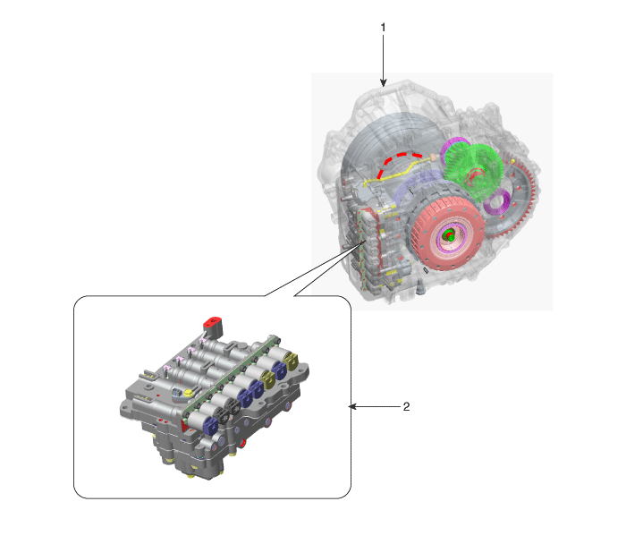
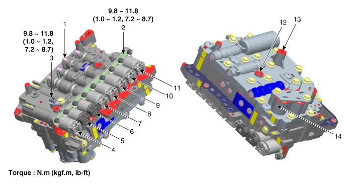
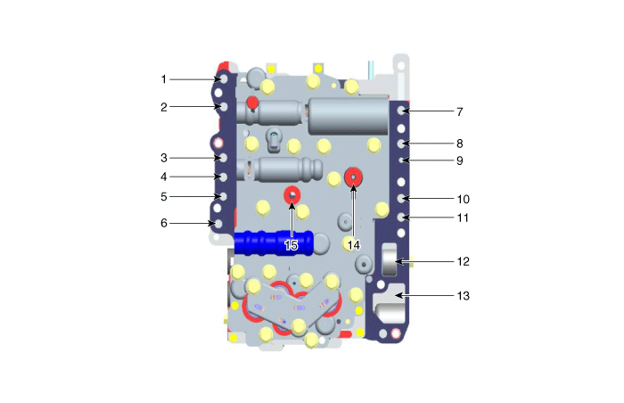

# Corpo de Válvulas — Componentes e localização

[Home](../../index.md) / [Manual de Serviço e Reparo](../sportage-482.md) / [Sistema de Transaxle Automático](sportage-683.md) / [Sistema Hidráulico](sportage-690.md) / Componentes e localização

## Diagrama — Localização

## Legenda — Localização

| Nº | Componente |
| --- | --- |
| 1 | Transaxle Automático |
| 2 | Montagem do Corpo de Válvulas |

## Diagrama — Localização

## Legenda — Localização

| Nº | Componente |
| --- | --- |
| 1 | Ajustador do Válvula Controladora de Pressão (PCV) |
| 2 | Suporte da Válvula Solenóide |
| 3 | Sensor de Temperatura do Óleo |
| 4 | Válvula Solenóide Controladora da Pressão do Óleo |
| 5 | Válvula Solenóide SS-A (ON/OFF) |
| 6 | Válvula Solenóide SS-B (ON/OFF) |
| 7 | Válvula Solenóide de Controle do Clutch de Overdrive (OD/C) |
| 8 | Válvula Solenóide de Controle do Freio de Underdrive (UD/B) |
| 9 | Válvula Solenóide 26 Freio (26/B) |
| 10 | Válvula Solenóide de Controle do Clutch 35R (35R/C) |
| 11 | Válvula Solenóide de Controle do Conversor Torretônico (T/CON) |
| 12 | Fenda de Fluxo de Pressão LR/B |
| 13 | Fenda de Fluxo de Pressão UD/B |
| 14 | Acumulador |

Fluxo de Válvulas do Corpo

## Diagrama — Localização

## Legenda — Localização

| Nº | Componente |
| --- | --- |
| 1 | Para o Refrigérante |
| 2 | De volta ao Refrigérante |
| 3 | Lubrificação (traseira) |
| 4 | Pressão do Clutch de Overdrive |
| 5 | Redução de Pressão (red2) |
| 6 | Redução de Pressão (red1) |
| 7 | Pressão de Liberação do Damper |
| 8 | Pressão de Aplicação do Damper |
| 9 | Lubrificação (dianteira) |
| 10 | Pressão do Clutch 35R |
| 11 | Pressão do Freio 26 |
| 12 | De volta ao Bomba de Óleo |
| 13 | Para a Bomba de Óleo |
| 14 | Pressão do Freio de Underdrive (UD/B) |
| 15 | Pressão de Baixa e Reversão |
